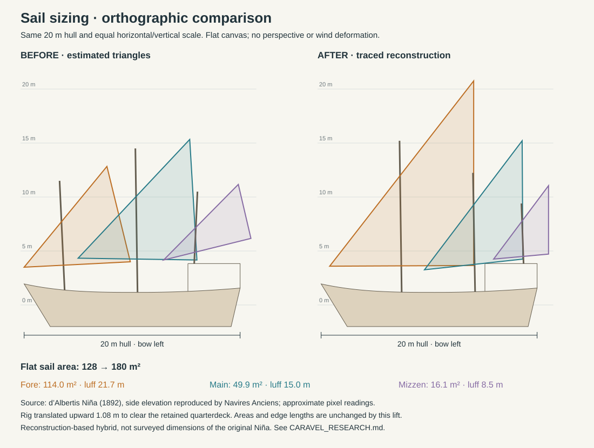

# Caravel shape and equipment audit — 19 October 2026

This is a reconstruction-guided game vessel, not a replica with surveyed offsets.
The established 20 × 6 m size and twelve-person company are retained. The hull baseline remains Martínez-Hidalgo’s Niña reconstruction. At the user’s
request, the active sail plan is a three-mast **caravela latina**
(all lateen). The converted square fore/main plan is retained separately for a
future model; the active vessel no longer claims that converted Niña sail plan.

## Drawings examined

- [Martínez-Hidalgo 1963 and d’Albertis 1892 Niña plates](https://navires-anciens.be/plans_de_la_nina/), reproduced by Navires Anciens. Visually inspected the sheer/profile, half-breadth and body views in both plates. The Martínez-Hidalgo plate guides this revision: narrowing forebody, curved/raked stem, finer underwater ends, full midbody and narrowing stern. These are differing modern reconstructions, not surviving fifteenth-century construction plans.
- [Mariners’ Museum Niña model](https://catalogs.marinersmuseum.org/object/CL21542), based on Martínez-Hidalgo hull drawings. Its inventory includes four falconets on the poop rail. Its rig follows a separate four-mast hypothesis; only its equipment inventory informs our guns.
- [Martínez-Hidalgo, *Columbus’ Ships*](https://www.scribd.com/document/305995423/Columbus-Ships), printed pp. 98–100, explicitly describes the converted Niña with square forecourse and maincourse, a lateen mizzen, no topsails, no spritsail and no round top. The tiller is described on p. 99; the general steering discussion places it on the main deck. The adjacent Pinta discussion supplies the Mediterranean runner convention, an inference for our Niña rig. Earlier pp. 21–27 and 38–39 inform the low forward deck.

## Implemented interpretation

`js/hull.js` now uses ten authored longitudinal breadth stations and monotone
Hermite interpolation. They are visually guided approximations, **not offsets
traced or measured from the plates**. CPU geometry and WGSL water exclusion share
the coefficients. The bow narrows sooner; the midbody has modest tumblehome;
forward and aft submerged sections become finer. A curved stem follows the same
surface. The 2.0 m design draft displaces about 107.7 t and calibrates the
simulation's fixed vessel/permanent-ballast mass, not historical tonnage or a
measured empty-ship weight. An authored 60-day manifest for twelve people adds
7.94 t (crew, water, food, containers and spares), giving 115.6 t displacement
and 2.086 m loaded draft. Hydrostatic integration determines the 8.6 cm sinkage;
no arbitrary visual waterline offset is applied. The modern
[Niña replica operator](https://www.ninapinta.net/) reports 7 ft (2.13 m) draft,
a useful scale comparison for a different reconstruction. Exact ration masses
and the fixed mass/ballast calibration remain simulation assumptions. See the
README loading section for quantities, cargo controls and limitations.

There is one continuous main deck and one partial raised quarterdeck, with cargo
space implied below. The tall forecastle tier and its ladder were removed. The
hold has no modeled interior, and there is no separate enclosed gun deck. Two
small rectangular stern lights replace nine ornate arched windows. Four hollow-
muzzled iron falconets sit on swivel forks on the aft rail, clear of deck routes.
They are visible equipment; aiming, firing, ammunition and recoil are unimplemented.

The wheel is replaced by a direct tiller on the main deck beneath the quarterdeck.
The stock passes through a small stern port; a real opening in the forward cabin
bulkhead gives access. The helmsman follows the arm, with hands placed against it.
The player observes from the quarterdeck above. Control direction still commands
the desired turn; the forward-pointing tiller moves opposite the rudder blade.

The rig has three single masts with triangular fore, main and mizzen sails.
`SAIL_PLAN` drives mesh geometry, moving ropes, shader deformation, shadows,
wetness and aerodynamic area/height. `SQUARE_RIG_PLAN` retains the previous square
fore/main plus lateen mizzen for a future model, using the same generic rig code.
The active sail outlines and mast positions now follow the d’Albertis side
elevation, measured as described below. Hull/decks, working tackles, runners and
shorter bowsprit retain their existing interpretation. All three sails furl
independently and tack through the existing shared trim response.

### Sail-size audit

The previous triangles were estimated from appearance and had the wrong size
ordering. For this three-mast all-lateen version, the reference is the
[d’Albertis 1892 Niña plate](https://navires-anciens.be/wp-content/uploads/2020/06/Nina.jpg),
identified by the [reproduction page](https://navires-anciens.be/plans_de_la_nina/).
The adjacent Martínez-Hidalgo **two-mast** lateen drawing is a different rig;
its triangles are not mixed into this three-mast arrangement.

Measurements use the orthographic profile, not the inset painting or rendered
camera views. In the 669 × 473 px scan, the deck's stem/transom span is x = 88–391;
the waterline is y = 320. Normalize that 303 px span to our retained 20 m hull,
using the same scale in both axes. The cloth corners (high yard end, tack, clew)
are approximately:

| Sail | Image coordinates (px) | Previous flat area | Traced flat area | Traced luff |
|---|---|---:|---:|---:|
| Fore | (302,22), (100,282), (302,281) | 44 m² | 114 m² | 21.7 m |
| Main | (370,106), (233,287), (371,272) | 62 m² | 50 m² | 15.0 m |
| Mizzen | (407,169), (330,272), (407,265) | 22 m² | 16 m² | 8.5 m |
| **Total** | | **128 m²** | **180 m²** | |

These are scan-derived estimates, not printed historical dimensions. Reading a
corner within about 3 px means roughly 0.2 m per point at this scale; areas are
especially uncertain for the small mizzen. Decimal coordinates in code preserve
one uniform transform, not survey precision. The luff is the canvas edge along
the yard; the rendered wooden spar extends slightly beyond it.

`js/rig-plan.js` retains the source coordinates and transform. Mast feet, heads,
and rake are traced from the same elevation; the largest and tallest sail is
forward. Yard pivots intersect the supporting mast axes. The rig is translated
upward **1.08 m**, without changing sail edges or area, to clear our higher retained
quarterdeck. This is explicitly a hybrid of the existing hull interpretation and
this sail reconstruction. Camber, spar diameter, clearance, and working rope leads
remain authored. It does not establish the original Niña's exact rig or sail area.

Regenerate with `node scripts/sail-plan-audit.mjs`. The new area and sail heights
also feed propulsion and heel; they are not a visual-only enlargement. The old
square plan and its mast dimensions remain separate for a future vessel.

The [modern replica operator](https://www.ninapinta.net/) explicitly describes
its Niña as a **caravela redonda**, with square fore/main and lateen aft sails.
Its header sailing footage shows useful near-hull whitewater and a steadier
attitude, but the camera motion, wind, speed and wave spectrum are unknown; it
cannot calibrate our roll coefficients. The user-requested all-lateen version
is a different caravel interpretation, not a correction to that operator’s rig.
The previous converted Niña interpretation and its sources remain recorded above.
No exact replica claim is made for sail proportions, hull offsets, equipment,
rope count, crew complement or accommodation. Yard lowering, detailed block
systems, sail interference and historical tacking drills remain approximations.

## Simulation implications

The shared hull changes ocean masking, contacts, deck-wash width, displacement,
inertia and keel resistance together. Contact normals now follow the actual
planking gradient. Relative wave rise drives bounded quadratic impact forcing;
receding water or a stronger new strike re-arms bursts. Paired contact spans form
broader sheets, then mist breaks from their airborne lips. Sheet landings add
foam. This is still an authored visual response, not a slamming-pressure CFD model.

Crew climb the same central runners rendered by `js/rigging.js`; alternating
hand grips and simplified boot locks follow those ropes. Work gates sail movement,
and the carpenter closes a visible hatch. The lookout holds below the foremast
head; there is no platform to enter. Nearby crew fade in the helm camera;
exterior appearance and shadows remain intact. See [CREW.md](CREW.md).

Roll and pitch now integrate inertia and restoring moments against hull-filtered
incident-wave slopes. Wind torque acts on the same roll state; rate-dependent
apparent wind can damp that rocking. The model follows the structure of
[Kerdraon et al., *Ocean Engineering* 212 (2020) 107668](https://doi.org/10.1016/j.oceaneng.2020.107668),
not its yacht-specific coefficients. Effective added inertia and damping are
explicitly authored. Continuous speed-squared hull pressure also feeds crest/trough
waves into the existing ocean displacement field in calm water, with a small
waterline ribbon for immediate contact. This remains a bounded local wave model,
not a calibrated dispersive Kelvin-wake or diffraction solver.
