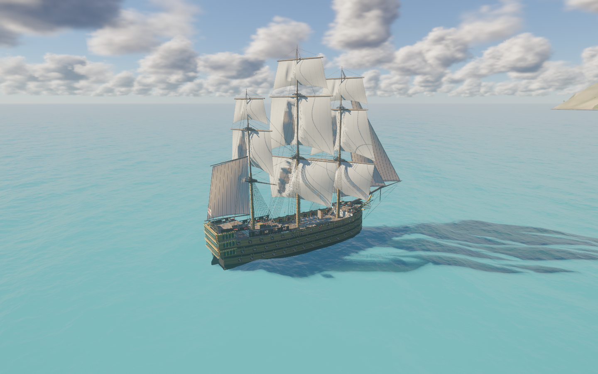
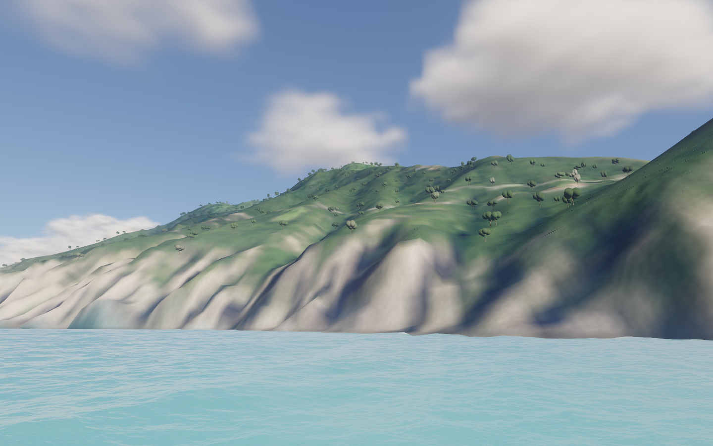
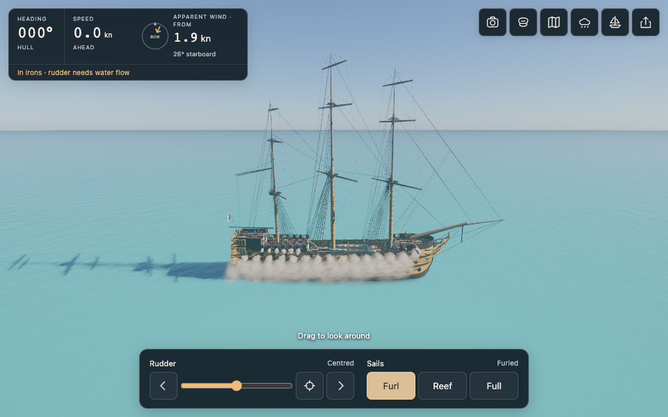
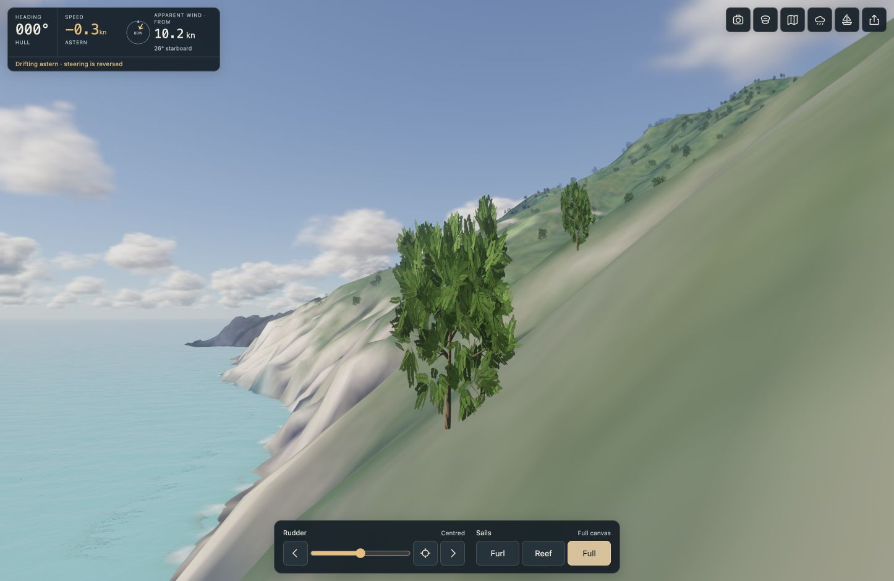

# Ocean Sailing Simulator

Built on [Noniv/web-ocean](https://github.com/Noniv/web-ocean).

A real-time WebGPU sailing game with wind, oar and paddle propulsion, crew, impact spray, deck wash, whitecaps, volumetric weather and marine encounters. The published game includes **nine vessel models**, independently selectable AI fleets, and an astronomical Sun, Moon and starry night. Boat, free-flight and exterior cameras share the same sea. Conditions, fleet choices and astronomical settings can be saved in a link.

[Open Ocean Sailing Simulator](https://healdgar.github.io/caravel-ocean-sim/).

**Release status:** published runtime
`3ba18f9cc6b88cc4be5d116e6110bdcb45f2a8da` retains **nine model choices and up to
nine active vessels**, adds the bounded Forestmodeler scenery adapter, and connects
real oar/paddle crossings to the shared surface-wave field. The full native Metal
suite passed **709/709**, zero skips or cancellations, in **351.361 seconds**;
eight Python importer checks pass separately. Visible Chrome reviewed imported
trees, automatic detail, coarse debug crowns and the rowing scene without console
errors. Pages built at **2026-10-22 12:59:14 UTC**; public HTML, manifest and all
**58 assets** matched tested local sizes/hashes at **12:59:54 UTC**. No
physical-iPhone or sustained frame-rate result is claimed.

The nine-vessel integration `c8a660d` passed **687/687** native checks and rendered
review of the five added models and mixed fleet; its 53 public assets were verified
at **2026-10-22 11:05:32 UTC**. [Exact receipts](BACKLOG.md#nine-vessel-integration--published-and-byte-verified).

The preceding Sun-control runtime `7c0b527` passed **573/573** native checks,
followed by rendered/mobile/offline review; its public bytes matched at
**2026-10-22 05:09:53 UTC**. [Exact receipts](BACKLOG.md#sunenvironment-controls-checkpoint).

The published checkpoint reduces repeated crew, vessel and ocean shading work,
targets 60 FPS with adaptive resolution, broadens contact-driven bow whitewater
and connects hard water contacts to timber groans. It retains underwater lighting,
distance-filtered terrain, cast-iron materials, sail shadows and the Wells Bay
approach.



Project code is **MIT licensed**, copyright © 2026 **Six Cailloux, LLC**, with
the original author's notice retained. See [LICENSE](LICENSE) and
[third-party asset/code notices](THIRD_PARTY_NOTICES.md).

[Try the Saba landfall MVP](https://healdgar.github.io/caravel-ocean-sim/?landfall=approach&boat=1).
Open **Landfall** to choose Horizon, Approach or Wells Bay approach, and compare clear air,
sunset, backlighting and sea mist. The world overview locates Saba; only this island
currently renders in 3D. Real LiDAR relief and aerial imagery now seed its terrain
and vegetation. [Longer-term geography and voyage design](LAND_SYSTEM_DESIGN.md).

The closest scene starts enabled vessels offshore from **Wells Bay**, with the bow
and swell directed toward the bay. Each ship still receives independent draft
clearance; explicit shared camera and sea settings override the defaults.
Real Wells Bay has a small, seasonal coarse black-sand beach
([Saba Tourism](https://www.sabatourism.com/tour-item/swimming-on-saba/)).
The current terrain supplies its broad coastline; a detailed beach, port
structures, depth-driven breaking surf and swash are still pending.




| 75 degrees off the sun, 2.4 m up | Looking toward the sun from 30 m up |
|---|---|
|  |  |

## Cannon drill

Open **Captain → Gunnery**. Prepare a side, wait for the crew's readiness report,
then order one broadside. Guns load, run out and recoil; solid round shot inherits
the ship's motion and follows gravity and aerodynamic drag. Wave contacts drive
water impacts. Brief muzzle flashes light the ship; dense powder smoke follows
wind and respects scene depth. Enable sound for captain orders, crew readiness,
carriage work and delayed cannon reports.
Loaded guns require current sea clearance; awash gunports hold fire.

Niña uses her four small swivel guns; Victory uses her 104-gun arrangement.
The visible watch demonstrates selected deck-gun teams; interior teams are
abstracted. Damage, penetration, ricochet and AI combat are not yet modeled.
[Implementation, historical sources and assumptions](GUNNERY.md).
[Audio review and provenance](GUNNERY_AUDIO.md).



## Run it

You need a recent Chrome with WebGPU and a reasonably capable GPU. On a laptop, force Chrome onto the dedicated GPU in the Windows graphics settings, or it will fall back to the integrated one.

Open `ocean.html` directly in the browser. `ocean.min.html` is the same page minified. Both include the ship's oak material and are self-contained.

To run from source:

```
npm install
npm start        # serves http://localhost:8080/
```

After editing anything under `js/`, run `npm run build` to regenerate `ocean.html`, `ocean.min.html`, and `docs/index.html`. The minified build strips WGSL comments and whitespace and minifies the JavaScript with esbuild. Building locally does not publish the changes; see [GitHub Pages build](#github-pages-build).

### Graphics architecture

All scene graphics use WebGPU by default, including every player, AI, companion
and background ship. Models supply data to the shared deformation system;
visible geometry, shadows, underwater capture and wetness reuse one GPU pose.
Anchor/rode expansion, cannon recoil and crew tools also remain on the GPU.
JavaScript prepares assets once and supplies sparse physics, decisions, joints,
instance transforms and compact controls. Any CPU graphics exception requires a
measured advantage and regression coverage. See [the execution contract](GPU_ARCHITECTURE.md).

Registry-driven tests exercise every renderable ship, including future model
entries, and deliberately inject CPU animation, mesh uploads and skipped GPU
dispatches to verify rejection. Native tests separately compare actual GPU
geometry with independent CPU references and frozen source samples.

The **Performance stats** dock button opens live FPS, CPU frame work, actual
render dimensions, resolution mode and vessel counts. GPU pass details enable
only while the panel is open; closing it restores lightweight endpoint timing.
GPU timing windows include waits and must not be added together as pass costs.

Startup shows actual graphics, ocean, ship/crew and weather preparation stages.
The loading screen stays until the first rendered canvas frame completes on the
GPU. Errors stay visible with Retry; slow first visits get an explanatory hint,
without a guessed percentage or failure timeout. Reduced motion and mobile
safe areas are supported. The website uses separately cached media; the two
downloadable HTML files retain their embedded assets and work offline.

Ordinary sailing preloads only the wood texture and two crew models (2.77 MB
before HTTP compression). The 8.32 MB whale asset loads on the first shark or
whale encounter, with preparation/retry feedback; encounter time pauses during
loading. Explicit whale/shark share links still prepare their requested animal
before showing the scene. Matching ships reuse immutable wetness probe layouts
and underwater material pipelines, while crew positions, moisture, GPU buffers
and vessel bindings remain independent. Coastal terrain is still scene-gated;
audio still loads only when enabled.

### Local authoring credentials

Keep the project-specific ElevenLabs key in `.env.local` as
`ELEVENLABS_API_KEY=your-key`. Start from `.env.example` and set file permissions
with `chmod 600 .env.local`. This is a plaintext local credential readable by
your Mac account, so subsequent asset generation needs no 1Password prompt.
Local Node authoring commands can load it with `--env-file=.env.local`.

`.env.local` is ignored by Git, blocked by the development server, and excluded
from the explicit file list used to build the standalone pages and GitHub Pages.
Restart any development server started before this protection was added.
Only generated audio belongs in the game; never import credentials into `js/`
or copy them into `assets/` or `docs/`.

### Sound sample authoring

The local ElevenLabs CLI reads `.env.local` directly, without 1Password:

```sh
npm run audio -- plan                   # offline prompts, model and durations
npm run audio -- generate hull-slap     # one paid sample
npm run audio -- pilot                  # six paid samples, 59 seconds total
npm run audio -- plan --set weather     # inspect weather prompts, no API call
npm run audio -- weather --take 01      # seven paid weather samples, 84 seconds
npm run audio -- plan --set nature      # inspect seabird prompts, no API call
npm run audio -- nature --take 01       # three paid bird candidates, 12 seconds
npm run audio -- review --take 02       # local listening page, no API call
npm run audio -- review --selected      # selected takes and nondestructive edits
```

Enable **Sound Effects** permission on the ElevenLabs key. The CLI uses the
[official sound-generation API](https://elevenlabs.io/docs/api-reference/text-to-sound-effects/convert)
and `eleven_text_to_sound_v2`. Preview files use its standard 44.1 kHz / 128 kbps
MP3 format. The first batch contains steady and strong wind, hull wash, light
and heavy wave impacts, and a timber creak. These are audition candidates;
generated output still needs listening, editing and in-game balancing.

Prompts and intended simulation drivers live in `scripts/audio/pilot.json`.
`scripts/audio/weather.json` adds distant thunder, a nearby thunderclap, light
and heavy rain, snow contact, sleet and hail. `weather` generates only that set;
`pilot` still generates only the original ship sounds. `generate` accepts IDs
from any set, and `review --selected` combines the chosen samples.
`scripts/audio/nature.json` adds nearby gull calls, distant seabirds and a tern
variant. These are isolated calling phrases rather than repeating ambience beds,
intended for occasional positioned events with long, varied gaps. Water and wind
remain separate layers. **Seabird activity** controls occasional positioned cries;
rain and strong wind suppress them.
The selected bird sample is an isolated 1.25-second gull cry; busier distant-flock
and tern candidates failed listening review and remain withheld.
Thunder uses each lightning event's direction and distance, with a propagation
delay of distance / 343 m/s. Precipitation uses independent loops for
type and intensity; deck impacts fade as the camera leaves the ship. Snow reuses the existing
wind layer without an added precipitation track. Two optional snow/canvas-contact
candidates sounded like footsteps or coarse brushing and were rejected. If a
convincing contact detail is selected later, its boosted audition level must not
become its in-game volume.
Audio, request records, checksums and returned credit costs stay in ignored
`.audio/pilot/`. Completed takes are reused; concurrent duplicate submissions
are blocked. Failed or interrupted requests are never automatically retried.
After inspecting a failure or deliberately requesting another variant, use a
new take name, e.g. `npm run audio -- generate hull-slap --take 02`.

The review command uses `ffmpeg` to decode completed, checksum-verified takes
into stereo WAV listening copies in ignored `shots/audio-review/`. It gives
each copy a -6 dBFS peak ceiling before integer conversion, preventing decoded
MP3 overshoots from clipping. Originals remain untouched; these audition levels
are not a physical sound mix. With the development server running, open
`/shots/audio-review/` to hear isolated samples and repeating ambience loops.
This review page is not part of the deployed game.

`scripts/audio/review-selection.json` retains per-sample selections and listening
feedback. The accepted hull wash and timber creak keep their original takes.
The light slap uses a nondestructive tail cut/fade. Edits can also retain a source
interval, apply a high-pass/high-shelf EQ, and blend the tail into the head for
a seamless wind loop. The loop is shorter by the crossfade duration; all edit
settings are saved with the selection and included in its WAV filename hash.
Replacement prompts establish
a wooden-sailing-ship setting, then isolate one source; wind calls for unpitched,
irregular airflow. Listing too many surrounding objects produced unwanted
foreground sounds in some takes. Listening decisions and rejected candidates
are recorded in `scripts/audio/review-log.json`.
Generation records preserve the original prompt for
every take even when the current recipe changes. Argon auditory reviews through
the user-requested `agy` CLI are staged separately under ignored `.audio/`;
credential files are never supplied to that reviewer. Its perceptual comments
guide selection; approximate reported timestamps are checked against the audio
duration and waveform before editing.

The [hull and wave audio refinement](assets/audio/README.md#hull-and-wave-audio-refinement)
uses continuous contact-driven wash and sparse, softer accents. A convincing
lower-hull crash texture remains unfinished. Ten canonical lower-bilge/keel
probes now distinguish actual underside exposure and return from ordinary
waterline wash; their geometric encounter speed is not a calibrated slam force.

The selected twelve sounds are integrated. **Sea settings → Enable sound** starts Web Audio
from a user gesture; **Mute sound** suspends it. Nothing contacts ElevenLabs at
runtime. Steady/strong wind blend with apparent wind; hull wash follows signed
speed, wetness and wave pressure, including waves against a stationary ship.
GPU bow contacts trigger quiet accents only after the previous wave recedes.
Underside returns suppress a coincident light-splash accent while the wash
continues. They retain dry/wet transitions on the GPU between audio readbacks,
discard stale/reset events and add no query work while sound is disabled.
Roll, pitch and heave motion trigger spaced timber creaks. Nearby
and distant thunder follow the same events as the visible flashes. The mix has
bounded event voices, smooth gains and a master compressor. Background tabs
suspend sound and discard pending events rather than replaying a backlog.

`node scripts/audio-promote.mjs` reproduces the selected edits locally, encodes
gapless-tagged MP3s into `assets/audio/`, writes their checksums/provenance, and
regenerates `js/audio-assets.js`. Rejected takes remain excluded. `npm run build`
embeds the twelve files in both downloadable ocean pages; GitHub Pages serves
the same bytes as versioned files fetched only after sound is enabled.
Credentials, request records and audition pages are excluded. The compressed
audio totals about 2.1 MB, decoded only after sound is enabled. Gains and ranges
are authored approximations, not calibrated acoustic pressure measurements.

`node --test tests/audio-authoring.test.mjs` checks local key loading, duplicate
charge prevention and error redaction without contacting ElevenLabs.

## Rain and lightning

**Sea settings → Thunderstorm** sets pouring rain, dense low storm clouds and
intermittent lightning. It leaves wind, waves and sailing speed under their
existing controls. Precipitation intensity, type (rain/snow/sleet/hail) and
lightning frequency are independent sliders/selectors; clear conditions remain
the default. **Stop precipitation & lightning** stops new weather effects.
Shared links preserve these settings. `rain=1&thunder=1` also enables them by URL.

Wind-driven precipitation occupies a camera-centered world volume with at most
24,000 instanced streaks/pellets (6,000 snowflakes), no particle CPU simulation,
no depth writes, and the scene's normal depth test. Particles fade at the volume
boundary and are suppressed below the ship's decks. Rain adds distance haze and
wets exposed wood, ropes, sails and crew through the existing material moisture
system; the covered tiller space stays sheltered. Moisture drains and dries.
Snow/sleet/hail are visual variants, without accumulation or an icing simulation.

Lightning has irregular, separated discharges, branched bolts and short return
strokes. Cool flash illumination reaches clouds, ocean, ship, sails, crew, spray
and land before HDR tonemapping. The flash is evaluated live, avoiding stale
illumination in cached cloud/reflection textures. This is broad cloud lighting,
not an additional shadow-map light. There are no lightning damage mechanics.
Thunder follows the distance delay; setting **Lightning & thunder** to zero
disables flashes. The weather clock never fast-forwards ship physics.

## Sun controls and astronomical sky

For night, open **Sea settings → Sun, Moon and stars**. In **Manual Sun**, drag
**Sun elevation** below 0° for sunset/twilight and below −18° for full night.
Choose **Astronomical sky** and a nighttime date/time at the selected location
for the actual Moon, stars and moonlight. Editing a Sun slider selects Manual Sun.
Sun elevation spans −90°…90°; Sun azimuth, wind and swell direction span 0°…360°.
Signed azimuths in older links retain their equivalent direction.

Open **Sea settings → Sun, Moon and stars → Astronomical sky**. Set an explicit
date/time, latitude and east-positive longitude; the default observer is Saba.
The sky has its own unwrapped clock, separate from the 600-second wave-spectrum
loop. Real-time progression is the default; a labeled sky-clock rate or pause
changes astronomy without fast-forwarding ship physics. Manual Sun mode remains
the default, preserving existing links and authored lighting controls.

Locally pinned Astronomy Engine calculates separate topocentric Sun/Moon
positions, lunar phase, apparent radius and the illuminated limb. A locally
attributed HYG catalogue provides magnitude, colour and Cartesian proper motion;
precession/nutation and the observer's horizon place historical stars. Optional
constellation lines respect depth, horizon and clouds. The dark and lit Moon
both occult stars. No runtime map, astronomy API or CDN is required.

Moonlight reaches clouds, reflections, ocean glints/foam, sails, hull, crew,
vegetation, wet surfaces and underwater scattering/caustics. The Sun is never
rotated into a fake Moon. Production shaders use an explicit **528-byte Frame**,
retaining the previous 384-byte prefix. One cloud-light field and ship shadow
allocation prioritize the Sun above the horizon, then the Moon; the secondary
simultaneous light has no independent shadow/light-field map. Terrain caches
both directions. Bounded exposure adaptation is separate from light energy.

Share links store mode, current date/location, rate and star/guide options;
`window.oceanAstronomy` exposes the state locally. Dates use an explicit
proleptic Gregorian/UT-like convention, including historical scenarios. This is
not certified navigation accuracy: historical Earth rotation, stellar apparent
corrections, procedural Moon detail and airglow retain documented approximations.
Sextants, lessons and navigation assistance come later. [Implementation and
reference conventions](ASTRO_NAVIGATION.md); [licenses](THIRD_PARTY_NOTICES.md).
The current native/packaged suite and rendered night checks passed, and the
runtime is published with verified bytes. Navigation accuracy and physical-iPhone
performance are unqualified.

## Controls

| Input | Action |
|---|---|
| Drag the canvas with a mouse or finger | Look around; orbit in View ship. The mouse remains free after release; no pointer lock. |
| Rudder arrows / slider | Set port or starboard rudder; arrows change the target by 5° |
| Centre rudder icon | Set the rudder target to zero |
| Furl / Reef / Full | Order all sails to 0%, 50%, or 100%; the crew handles the canvas |
| W A S D | Move in Free camera; A / D steer in Boat camera |
| Left / right arrows | Steer in Boat camera |
| X | Centre the rudder |
| B | Switch between Boat camera and Free camera; board from View ship |
| Space or E / Q or C | Up / down in Free camera |
| Shift | 5x Free camera speed |
| Mouse wheel | Change Free camera speed or View ship zoom |
| Drag in View ship | Orbit the vessel |
| Touch-drag the canvas | Look around or orbit in View ship |
| H | Settings panel: wind, swell, choppiness, turbidity, foam, sun, haze, clouds, exposure, bloom |

Free and exterior cameras can cross the waterline. In **View ship**, drag to orbit,
right-drag or Shift-drag to pan, and use the wheel to zoom close. On touchscreens,
two fingers pan and pinch zooms. **Centre inspection view** clears the pan.
Share links retain the inspection position. The boat camera still follows the hull;
rough seas can overtop the gunwales and wash across the deck.

The default view starts at the helm under **Sailing** propulsion. Heading,
speed through water and apparent wind stay above the scene; a compact rudder
and sail bar sits below. On desktop it uses one row; on phones, two. Finger
drag looks around without steering. The six icon buttons open **Camera views**,
**Captain**, **Landfall**, **Sea settings**, **Ship settings**, and **Copy share
link**. Icons have accessible names and desktop hover labels.

Only one secondary panel opens at a time. Its close button stays above the
scrolling content. On phones, an open panel temporarily replaces the helm bar;
navigation instruments remain visible. Phone buttons retain 44 px touch targets
with 20 px icons. Layout follows the visible viewport, safe areas and keyboard.
FPS/debug text is hidden on ordinary visits. `profile=1` enables it and adds the
Performance disclosure inside Sea settings.

URL parameters are handy for testing. `?w=2560&h=1440` forces the render resolution, `cam=x,y,z,yawDeg,pitchDeg` sets the camera, `fov=deg` sets the field of view, `ui=0` hides the HUD, and any settings key works too, for example `windSpeed=12&swellHs=2&sunElev=8`.

## Following ship, crew voices and encounters

The [ship-model foundation](SHIP_MODELS.md) separates immutable model definitions,
named attachment points, semantic mesh groups and cached geometry from each
vessel's live state. The first four models are **Niña, Pinta, Santa María
and HMS Victory (1805)**; the five later vessels are described below. Choose
**Ship settings → Vessel**, or [sail Victory](https://healdgar.github.io/caravel-ocean-sim/?ship=victory&boat=1&view=ship).
Victory has her own 56.69 × 15.85 m hull, three gun decks with an open waist,
104 represented guns, stern galleries, wheel, boats, stepped masts and fighting
tops. Eight square sails, three headsails and a gaff spanker use shared posed
geometry for forces, rendering, running ropes, shadows and wetting. Fore/main/
mizzen controls operate mast groups; they do not represent individual sail handling.

[Victory's source ledger](VICTORY_RESEARCH.md) distinguishes reported dimensions,
surviving fore-topsail measurements and sections measured from the supplied
Meshy reference from authored underwater offsets, spars and rigging. The fuller
rounded bow, changing stern sections and inward-curving upper sides share one
fair hull definition across geometry, water exclusion and hydrostatics. Deck
edges, bulkheads, wales, rails and end closures join that same surface. This is
a game reconstruction, not a digitized Admiralty model or calibrated naval
simulator. Her hydrostatics integrate her own hull at an
**authored 8.8 m service draught** (about 4,905 tonnes in this geometry); the reported
2,162 tons builder's measurement is never used as displacement. Mass, inertia,
wind shear and canvas incidence drive motion; requested speed supplies no motor
thrust in sailing mode. Twelve visible sailors represent a working watch; the
loading manifest accounts for 820 people. Their existing costume set remains
shared with Niña rather than representing an 1805 uniform reconstruction.

The published Pinta and Santa María have separate hulls, decks, equipment,
crew stations, helms and mixed rigs. Pinta uses two square courses and a lateen
mizzen; Santa María adds a main topsail and spritsail, four exposed deck zones and
the requested foremast lookout. Pinta's 25.908 × 7.0104 m size profile comes from
an enlarged modern replica. Santa María uses the replica's reported 28.30 × 7.96 m
profile with an authored 1.95 m service draft. Their underwater offsets, working
sail dimensions and four small swivel guns are authored interpretations, not
recovered 1492 plans or inventories. [Source/assumption ledger](SHIP_MODEL_RESEARCH.md).
Reported tonnage remains separate from displacement and simulation kilograms.

**Ship settings → Fleet** offers up to **eight independently enabled followers**
plus the player. Choose each follower's model, add/remove or disable rows, then
apply the selection; resource changes reload the scene. **Camera views → View
fleet** frames the enabled ships. An omitted `fleet` parameter preserves the
legacy same-model escort; `follower=0` still starts alone. Explicit links use,
for example, `ship=nina&fleet=pinta,santa-maria,victory`; `!pinta` preserves a
configured disabled row without allocating its GPU vessel. Share links retain
the roster. All nine model choices below are published.

Immutable geometry, indices and render assets are shared per model; crew geometry,
one FFT ocean and weather remain shared. Every enabled ship owns its posed
geometry, hull/rig state, company, sea probes, moisture, wake and equipment where present.
Two pooled wake banks and three shadow texture arrays have one layer per active
vessel, with variable hull masks and probe dispatch; disabled rows allocate none.
The nine-ship limit is a resource bound, not a device performance guarantee.

Pinta/Santa María and the five additional vessels evaluate cloth,
spars, ropes and attachments through one
CPU pose, uploading the same vertices used by visible, shadow, submerged and
wetness paths. Victory retains shared GPU deformation. The new passive lateral
model integrates the loaded hull silhouette and actual exposed keel geometry;
its distributed forces supply sway, yaw and roll moments alongside sail moments.
An inferred geometric centre of lateral area is not a calibrated dynamic CLR.
No fabricated fin, motor thrust or zero-flow steering assist is added.

Followers issue ordinary sail and helm commands, compensate for leader motion,
station rotation and leeway, and trim sail while holding distinct formation slots.
They commit to tacks and actual sternway recovery; rudder authority requires water
flow. Avoidance and station-keeping remain authored AI policies, not passage
planning, a ship-collision solver, combat or hailing. A following ship with no speed
advantage cannot guarantee closing every gap. Published nine-model fleet checks
and final rendered reviews passed.
These policies are not calibrated historical maneuvers.

The [nine-model release](SHIP_MODELS.md#later-vessel-programme) includes these
five additional hulls, rig/rowing poses, companies, controls and equipment:

| Model | Default size and basis | Physical propulsion | Represented / loaded people |
|---|---|---|---|
| Oseberg-based vessel, c. 850 | 21.5 × 5 m hull | One square sail, 30 oars, steering oar | 32 / 32 |
| Lusoria Rhenana interpretation, c. 350 | 18 × 2.8 m hull | One square sail, 24 oars, steering oar | 26 / 26 |
| Taíno-style canoe, c. 1492 | Authored 14 × 1.8 m | 24 paddlers and a steering paddle; no rig | 30 / 30 |
| Flying Cloud, 1851 | 68.58 m deck length × 12.50 m beam | Three-mast full rig; wheel and rudder | 12 / 42 |
| Gipsy Moth IV, 1966 | 16.18 m LOA × 3.20 m beam | Two-mast Bermudan ketch; tiller and rudder | 1 / 1 |

All five are unarmed. The canoe has no anchor, sails or placeholder masts; its
inapplicable controls are absent. The others have model-owned anchor fittings.
Gipsy Moth's recorded engine is disabled. Its headsails/main/mizzen controls serve
two physical masts; Oseberg and Lusoria expose only their one main-sail group.

At the helm, rowing craft use **Rest / Easy / Full** effort and turn demand;
**Ship settings** gives stroke rate in strokes per minute. Wind and rowing may
act together where sails exist. Actual blade movement, crew hands/feet, moving
water contact and bounded human loads share one stroke. Dry recovery adds no
drive. Rowing followers use those ordinary controls, without motor assistance.

Reported hull/replica dimensions remain distinct from authored offsets, working
canvas, draft, equipment and loading. The canoe is a regional design target,
Oseberg is an AD 820 archaeological reference used for a c.850 scenario, and
Lusoria is a late-Roman riverine reconstruction. Flying Cloud's 25 cloth surfaces
and 15 yards are implementation counts; its working crossjack cloth, staysails
and sheet limits are not a certified historical inventory. Gipsy Moth selects the
original design-DWL branch, keeping later refit figures separate. See the
[source and uncertainty ledger](SHIP_MODEL_RESEARCH.md).

**Enable sound** in Captain or Sea settings to hear the new voices. The 12 named
crew each have a distinct, reusable voice saying “Aye captain!”: Inês, Tomás,
Beatriz, Duarte, João, Catarina, Leonor, Rui, Maria, Afonso, Isabel and Pedro.
The player’s eight orders use a separate original rough Cornish voice,
**Captain Trevenen**. A captain command is followed by a rotating crew reply;
repeated input keeps only the newest pending exchange. Captain Inês can be
previewed, but the default crew response rotates among the other 11 hands.
**Sea settings → Crew voices** previews each named voice.

The new 23 MP3 assets include 12 acknowledgments, eight orders, a water plunge,
tackle release and a hemp-rope/windlass loop. They total about 487 KB. Argon
listened to the generated takes, rejected several noisy/truncated performances,
and approved the selected replacements and final captain lines. Runtime audio
uses the existing gesture-enabled Web Audio context, spatial attenuation,
volume, mute and visibility controls; the windlass starts only when needed.
No generation requests or API credentials run in the game. Local authoring uses
`scripts/voices.mjs`; selected provenance is in `assets/audio/voices/provenance.json`
and `scripts/audio/voice-selection.json`. Private journals remain in ignored
`.audio/voices/`.

### Anchoring

Use **Landfall → Wells Bay approach**, slow below **1.5 knots**, then choose **Captain →
Drop anchor**. It is available only inside the loaded coastal depth domain,
with visible land within 2.5 km, safe under-keel clearance, at most 35 m depth,
and enough hemp rode for 5:1 scope from the bow: 200 m on Niña/Pinta/Santa María,
260 m on Victory. These are authored equipment assumptions. Haze, rain,
cloud base and the horizon affect the visibility proxy. Open ocean has no
valid sounding and cannot be anchored.

The port anchor leaves its cathead, falls through the water with a splash,
reaches the bed and pays out rode. Only bottom contact reveals depth in fathoms
(1 fathom = 1.8288 m). **The Saba underwater skirt is authored, not surveyed
bathymetry; the readout explicitly says “simulated sounding.”** The seabed anchor
retains its world position/orientation while the ship swings. A slack rode
cannot push; tension acts through ordinary hull inertia and yaw. Holding
strength is finite and the anchor drags under excess load. **Weigh anchor**
hauls the ship toward its anchor, breaks it out and retrieves it progressively.
The starboard spare remains stowed. Each enabled vessel owns its anchor and rode
state, with model-specific fittings and equipment; player commands operate the
lead ship’s port anchor.

### Dolphins

Pods of 5–7 dolphins visit occasionally in fair weather. Each opportunity waits
at least seven minutes plus an exponential interval averaging 15 minutes,
including the first visit; use the debug trigger for immediate viewing. Encounters last
about 105 seconds. The procedural animals swim, breathe, occasionally breach,
beat their tails and disturb the water as they surface and dive. Rising trunk
contact makes a small splash, reentry makes a stronger connected splash crown
and secondary droplets, and surface swimming leaves short broken ripple trails.
Tessellated rings expand from their world-space contact positions and follow all
six ocean wave bands; they fade after 4.2 seconds. Airborne/submerged dolphins do
not emit surface trails. The bounded 64-event pool uses fixed contact timing and
at most four trail stamps per second per animal, independent of render FPS.
Contact events also drive the independent shared surface-wave grid, adding real
ocean displacement without changing the global FFT spectrum. The local splash
geometry remains separate from those propagated waves. Its height samples the
displaced sea plus the shared disturbance field; the water depth test
occludes submerged bodies. They avoid the active hulls and water shallower than
six metres. Motion is authored wildlife behavior, not a hydrodynamic animal
simulation. No wildlife draw or effect pass runs while a pod is absent.

Flukes sweep aft from the tail stock, with a trailing central notch and a
0.75 m span on the 3.11 m model. Proportions follow the bottlenose measurements
in [PLOS ONE, Table 4](https://doi.org/10.1371/journal.pone.0255464).
The embedded roots, closed tail stock and outward skin normals remain continuous
through the production swimming stroke.

For immediate testing, open **Sea settings → Environment & encounters → Spot
dolphin pod**. **View pod** frames the animals; **End encounter** clears them,
and **Natural dolphin sightings** disables automatic visits. Debug URL options
are `dolphins=1&dolphinView=1&view=ship`; ordinary share links omit these debug
flags. Encounters use normal simulation seconds and do not fast-forward sailing.

### Sharks, whales and wet skin

Dolphins, sharks and whales share a wet skin material: a thin water clearcoat
adds narrow sun glints and sky reflections above the softer skin reflection.
Highlights follow the actual sun and camera and disappear when sunlight is absent.

### Shared underwater optics

Surface waves refract submerged geometry through one shared render path: both
ships, crew, anchors and rode, dolphins, sharks, whales and the shallow seabed.
The source pass captures posed materials below the displaced water surface.
The ocean bends the view ray using the current FFT, vessel-wake and shared
surface-disturbance normal, then applies
RGB depth attenuation before Fresnel reflection, sunlight glitter and foam.
Ripples therefore distort underwater silhouettes; grazing reflections and foam
obscure them. Deep animals lose contrast and detail, fading into the water color.

**Water turbidity** controls suspended-particle extinction as well as water-body
brightness. Clear water reveals more submerged detail; turbid water hides it
sooner. Refraction uses water's approximate refractive index of 1.333 and
Beer–Lambert attenuation with authored blue-green-water coefficients, rather
than measured local water samples. The resident coastal pack supplies an
authored shallow seabed, not surveyed bathymetry.

This is a screen-space approximation with one submerged depth layer. Missing or
off-screen samples fall back to ordinary water shading. Below the surface, the
same displaced ocean uses water-to-air refraction, a Snell window and total
internal reflection. A separate HDR pass applies wavelength-dependent extinction
and bounded sunlight/sky scattering before bloom. Scattering integrates a planar
homogeneous water column analytically, stops at the water exit, and uses a
normalized angular phase. A representative vessel-shadow sample attenuates its
direct-sun term. This avoids the old unshadowed additive solar glow and coarse
depth strata; it is not a full shadowed volume integral. Current GPU wave height selects
the camera's medium; CPU readback does not delay a crest crossing. Captured solid
radiance avoids applying air fog or the viewing water path twice. Captured seabed
can fill geometry deliberately omitted from the normal air-side draw.

Short/mid-wave slopes focus and defocus refracted sunlight on submerged solids,
including those viewed from above water. These moving **caustics** fade with depth,
turbidity, solar visibility and vessel shadow. They use a bounded local receiver-map
Jacobian with finite-beam regularization and actual rendered-pixel filtering,
not animated noise or a complete photon/multiple-scattering solver. Folded
single-ray maps fade toward mean irradiance; deep caustics fade continuously.
Captured vessel wood uses water-relative dielectric reflectance, retains absorbed
darkening and loses the air-side wet-film gloss. Hull and rudder share this optical
policy, while their authored tar/wood finishes remain distinct. Captured
reflections use a diffuse ambient approximation, not a reflected air-sky image.
Underwater reflections approximate the diffuse water body; above-water objects
are not reconstructed inside the refracted sky window. Profiling includes separate
**Submerged geometry** and **Underwater medium** spans. `waterOptics=0` disables
above-water object transmission for diagnostic comparison.

Optical basis: [PBRT refraction and Fresnel](https://www.pbr-book.org/4ed/Reflection_Models/Specular_Reflection_and_Transmission)
and [volume transmittance](https://www.pbr-book.org/4ed/Volume_Scattering/Transmittance),
plus [GPU Gems' water-caustics discussion](https://developer.nvidia.com/gpugems/gpugems/part-i-natural-effects/chapter-2-rendering-water-caustics).
Current development adds lunar underwater illumination and dominant-light wave
caustics through the [astronomical sky](#astronomical-sky-development). These
remain bounded optical approximations; navigation instruments are deferred.

Sail and rig shadows use continuously weighted tent filtering and a smoothed
blocker estimate at the existing 2048-pixel map size. Canvas edge coverage is
applied once, preserving transmitted colour. Shadow receiver planes follow the
rendered triangles; smooth normals remain responsible for material lighting.

Iron fittings and guns use a dark oxide finish with filtered cast relief, a small
exposed-metal fraction and a separate draining water-film highlight. These are
authored material values, not a measured Victory conservation finish. The shared
environment reflection remains an approximation rather than GGX-convolved IBL.

Cliff noise and fissures filter by their actual projected material footprint,
including oblique views. Unresolved grain loses contrast toward the registered
aerial colour rather than producing a moving pixel pattern. Bump shading guards
ill-conditioned surface gradients; nearby resolved detail remains available.

A separate, bounded marine encounter occasionally introduces a passing shark or
a 14.1 m sperm whale using the supplied straight Meshy model and its native 18-bone rig. Whale encounters include a full breach,
reentry splash, fluke dive and periodic blow. The shark swims with lateral tail
motion; whales beat their horizontal flukes vertically. Bodies and contact effects
follow the moving sea and shared surface disturbances. Whales require sixteen metres of clear water; sharks
require six. Automatic opportunities wait at least fifteen minutes plus an
exponential interval averaging thirty minutes and are suppressed in severe weather.
One shark/whale encounter can run alongside the dolphin pod. No wildlife draw is
submitted when those animals and their remaining surface effects are absent.

The whale uses a reduced 39,254-triangle derivative of the supplied 145,388-triangle
model, preserving its UVs, skin and three original texture images. Its straight
neutral pose needs no curl correction. Its rig has no animation clips; bounded tail,
fluke and pectoral strokes are authored on the existing bones and weights.
The breach joins swimming, launch, ballistic flight and recovery with continuous
position and first derivatives, including roll. The approach and recovery carry
vertical momentum through submerged dips; the airborne arc is unchanged.
This is an authored trajectory, not a hydrodynamic or species-calibrated leap.
Its brief blow emits soft condensate parcels and separate heavier water droplets
from the posed forehead outlet. The parcels
inherit forward motion, entrain into wind and disperse; coarse water falls under
gravity. GPU-cached launch heights keep airborne spray independent of later
waves. First descending contacts stop those drops and create small ripples at
the recorded locations. Breach sheets and spray also retain their launch height.
These bounded particle approximations are not a full fluid solver or a
species-calibrated respiratory model.

Open **Sea settings → Environment & encounters** for **Spot shark**, **Whale
breach**, **Whale fluke dive**, **Whale blow**, **View marine animal** and **End marine
encounter**. Natural sightings have a separate switch. Debug links accept
`shark=1` or `whale=breach|fluke|blow`, plus `marineView=1&view=ship` to frame the
animal. Encounter behavior and swimming motion are authored; there is no
biological behavior simulation or wildlife audio. The whale GLB and all three
textures are embedded in the standalone builds.

## Share your sea conditions

Open **Sea settings** and adjust the waves and lighting, then select **Copy share
link** in the top controls. The link includes every sea and lighting parameter,
boat length, beam, heading, speed, eye height, rudder setting, provisions, cargo, ship visibility,
wake/spray/deck-wash visibility, and the selected camera mode. Opening it restores those settings. The address
bar also receives the link; if copying is blocked, a selected text field lets
you copy it manually. Each copy captures your latest settings.

For crossing storm seas, select **Hella rough** in Sea settings: 28 m/s wind,
8 m swell, and extra foam. The sliders allow up to 32 m/s wind and 10 m swell.
[Try rough seas](https://healdgar.github.io/caravel-ocean-sim/?boat=1&windSpeed=28&windDir=123&fetchKm=300&swellHs=8&swellLength=95&swellDir=236&choppy=1.6&foam=1.7).
Links share the configuration; they do not freeze an animation frame or the
boat's travelled position.

## How it works

### Landfall MVP

Saba uses Beeldmateriaal Nederland's 2023 bare-earth LiDAR DTM, area-averaged and
reprojected from the half-metre source to a 513² grid at 16 m spacing across an
8.192 km region. Its fixed 104,972-triangle mesh preserves the same relief
throughout approach. Missing forest ground returns receive recorded interpolation;
the result is visual terrain, with source CRS/datum and shoreline limitations.

Licensed real aerial imagery supplies one registered 1024² colour seed at 8 m per
pixel. Gentle infrastructure cleanup and bounded shadow lifting preserve broad
green interior and exposed brown slopes. These approximate surface colours are
not calibrated reflectance or an exact reconstruction of historical land cover.
A derived greenness mask, elevation and slope select 17,466 stable trees from
360,000 seeded candidates in the current Saba pack. Camera distance changes
detail, not tree identity, position or regional density. The original 8 m colour
and 16 m elevation limits remain; additional trees do not improve source resolution.
Eight seeded tree variants use five generations of curved, tapering branches,
with children growing from actual parent sections. Hundreds of terminal twig
sprays carry individual leaf cutouts, veins and transparent gaps at near/middle
detail. Interior foliage receives authored canopy
occlusion, while outer leaves transmit sunlight. The original leaf texture is
reproducible with `python3 scripts/prepare-tree-foliage.py` (Pillow and NumPy).

Three detail tiers share the same skeleton, roots, height, radius and wind phase.
Distant trees use opaque envelopes derived from their actual primary boughs,
joined to the original trunk; they do not use crossed foliage cards. Their colour
uses the source leaf texture's integrated linear colour with bounded regional tint.
Conservative geometry-error bounds project through the actual rendered pixel
height, field of view and tree depth, with a 3-pixel target and 12% hysteresis.
This bounds geometry selection, not colour, alpha or a perceptually invisible
transition. Frustum culling excludes off-screen forest patches. Production budgets
of 96 near and 512 middle trees report overflow rather than silently degrading
trees that need more detail; instance buffers grow within the finite regional
population. This uses native WebGPU instancing and stable regional seeds.
The growth approach follows [Dan Greenheck's EZ-Tree article](https://tympanus.net/codrops/2025/01/27/fractals-to-forests-creating-realistic-3d-trees-with-three-js/).
Species, coverage and canopy occlusion remain authored approximations.

Opaque ground, wood and distant crowns draw before cutout foliage, following
[Apple's tile-renderer guidance](https://developer.apple.com/videos/play/wwdc2020/10632/)
so those solid surfaces remain eligible for hidden-surface removal. Filtered,
metre-scale rock/soil relief adds close detail without blurring the registered
colour seed. This does not recover missing cliff geometry or high-resolution
imagery. The projected geometry bounds are measured offline with triangle BVH
queries and adaptive subdivision; this work does not run in the frame loop.

Deterministic grass clumps and irregular boulders now rest on the actual rendered
terrain triangles, including steep slopes. Four shared opaque meshes use native
instancing, regional culling and a three-render-pixel omission threshold. Grass
bends with wind; cached terrain sunlight avoids cloud ray marching per blade.
The material adds filtered metre-scale relief between aerial colour and close
soil/rock grain. These additions do not yet supply a closed distant forest canopy.

**Published canopy integration:** a separate Forestmodeler import adds a
bounded **80 × 80 m, 42-tree** demonstration near Saba's summit. Its five taxa
(fir, oak, birch, elm and maple) are temperate examples, not surveyed tropical
vegetation or whole-island coverage. Actual branch wood and cutout foliage retain
source linear material colours; procedural roots are replaced only inside the
imported rectangle. The source has no leaf image, so the existing leaf texture
supplies alpha only. Auto keeps detail unless the complete near/far patch support
fits within three render pixels; the opaque far preview is otherwise explicitly
uncertified. Imported trees are static and add no canopy shadow caster. Combined
native/rendered checks and deployed-byte verification passed in `3ba18f9`. See
[Canopy scenery contract, provenance and inspection controls](CANOPY_SCENERY.md).



The same sun, sky, atmospheric extinction and volumetric clouds light the sea,
ship and land. A cached terrain/cloud shadow field shades the slopes; foreground
cloud integration stops at terrain, allowing low cloud to veil the mountains.

The shore has approximate shallow-water tint, wave-contact foam and wet rock.
A swept hull-clearance constraint stops the ship entering the elevation-derived
coast. The underwater skirt is authored, **not surveyed bathymetry**. Deep-water
waves still lack coastal refraction, shelter and a physical surf solver.

All simulation clocks remain unchanged. This is a visual landfall slice: no ports,
docking, river currents, voyage compression, terrain streaming or complete grounding
model yet. The future target remains 15–20 minutes of offshore passage.
The source packs, licenses, checksums and rebuild instructions live in
[`assets/world/README.md`](assets/world/README.md). Both downloadable ocean pages
embed the island's height, imagery and vegetation mask plus the world chart.
GitHub Pages loads terrain and foliage for land scenes, and the world chart on demand.
The regular ocean scene does not allocate terrain GPU
resources. The automatic resolution target is now 60 FPS; combined
land/ocean performance still needs a physical iPhone measurement.

### Waves

The sea is a Tessendorf FFT simulation with six cascades of 256 by 256 samples. The patches range from 1103 m down to 0.26 m, so wavelengths run from about a kilometre to a few millimetres. The smallest cascade produces the sharp sun sparkles near the camera.

The spectrum is a fetch-limited JONSWAP wind sea with Donelan-Banner directional spreading, plus a narrow long-crested swell. Dispersion includes the capillary term, and choppy horizontal displacement sharpens the crests. Spectrum evolution feeds directly into the first radix-2 inverse FFT in workgroup memory, followed by the column FFT.

The surface mesh is a CDLOD quadtree with 17 levels. Vertices are 6.25 cm apart near the camera and the mesh reaches 160 km, with continuous vertex morphing between levels.

### Caravel model

The procedural hull follows the Martínez-Hidalgo Niña reconstruction, with a finer bow, curved stem, full midbody, modest tumblehome and finer
underwater stern. [Research, sources and historical limits](CARAVEL_RESEARCH.md)
distinguish the authored interpretation from measured reconstruction offsets.
The earlier [generated reference](assets/caravel-design-reference.png) remains
art direction only.

One continuous main deck and a partial raised quarterdeck replace the tall
forecastle tier. Two small recessed stern lights replace the ornate window
rows. Four rail-mounted swivel falconets follow the Mariners’ Museum Niña
model's equipment list. They are modeled cannon, without firing mechanics.
Three single masts carry triangular fore, main and mizzen sails. The previous square fore/main configuration is preserved in `SQUARE_RIG_PLAN` for a future model; it is not the active rig.
A direct tiller replaces the wheel, beneath the quarterdeck. Topsails and large
mast baskets are removed. Raked masts, a shorter bowsprit and runners follow this
interpretation; exact offsets and complete period sail handling remain approximations.

The hull, camera, shadows, water exclusion, spray contacts and deck wash share
one geometry definition. Indexed mesh records preserve normals, material and UV
seams; no imported ship model or Blender dependency is required.

### Ship's company and captain's orders

Niña's company has twelve named sailors: six women and six men, using distinct
Quaternius-derived models. The deliberately diverse company includes Black,
white and East Asian appearances, two redheads, and individual skin tones, hair,
head/jaw shapes, nose profiles and eye openings. Appearance is fixed per sailor
and independent of role. Clothing, heights and animation phases also vary. Six tend short, separate routes on the main deck;
the others hold lookout, quarterdeck and helm stations. Strong wind, heel or roll
rate interrupts normal duties with a crouched brace. Each sailor uses the same
replaceable local decision policy, independently of rendering.

Open **Captain** for a separate orders panel: **Make full sail**, **Reduce sail**,
**Furl all sails**, **Prepare for heavy weather**, or **Resume sea watch**. These
are shipwide objectives, with no individual position controls. Sail orders select
wind-driven propulsion and assign work. Fore/main changes wait for an aloft
rigging hand and a deck hand at the halyard; the mizzen uses its quarterdeck hand.
Heavy-weather preparation requests 20% fore/main canvas, furled mizzen, and
a carpenter to close the visible weather hatch. Returning to watch retains sail settings.
Manual sail sliders remain in Boat perspective and supersede an outstanding order.
The captain panel has a persistent close button and scrollable roster; it opens
separately from boat and sea settings on mobile.

**Show crew** is a display switch, preserved in shared links as `crew=0/1`.
Hiding characters or the ship does not stop their simulation or sail orders.
Resized legacy hulls below 10.5 m long or 3.2 m wide hide their company because
those stations no longer provide sufficient clearance. Model-owned rowing craft
instead use their own narrow-hull stations and full represented complements;
Gipsy Moth has one working sailor. A representative watch is distinct from the
personnel mass in the loading model, as the table above records.

The original Quaternius crew remains the active asset family. Workwear has a
looser shirt silhouette, sewn collars and rolled cuffs, and trousers that bridge
the pelvis and seat rather than following the unclothed body sculpt. Smoothed
centre-seam normals avoid artificial creases. Heights, body skin weights,
joint lengths, animation curves and hand targets are preserved; the belt follows
the adjacent garment weights through bends.
Both embedded GLBs total 2.21 MB. Each has 65 joints and Idle, Walk and Brace
clips; the male model has 15,995 triangles, the female 18,720. Each company uses
up to two instanced draws in the ship pass and two in the existing solid shadow pass,
with independent bone palettes. They receive ship/sail shadows. No render pass
is added. The automatic-resolution target is now 60 FPS; the expanded
crew's physical-iPhone performance has not yet been measured.

Crew follow bounded authored routes, yield to nearby bodies, climb the rendered
runners with procedural two-bone IK, haul shared tackle leads, then return to
stations. The lookout periodically climbs a foremast runner, below the mast head.
Dangerous heel, roll rate or strong wind pauses work; climbers retain their holds.
The helmsman follows the tiller beneath the quarterdeck. Nearby sailors become progressively transparent
in the first-person camera; shadows and exterior visibility remain intact.

This is an executable local job system, not a general planner or a historically
exact reefing drill. Free navigation, yard crawling, fatigue, anchor deployment,
cannon firing and autonomous steering remain
future work. The policy can choose work, wait or brace; safety remains in the
executor. No remote decision service or new rendering pass is added.

[Asset provenance and rebuild instructions](assets/crew/README.md) retain the CC0
licence, source revision and checksums. [Crew and decision-system design](CREW.md)
describes the larger decision and work-execution system.

The **Meshy replacement experiment is shelved** in favour of refining the
original crew. The local **Meshy 7.1 CLI** remains available for future requests:
`npm run meshy -- help`. It reads credentials from 1Password, preserves generation
requests and task IDs locally, downloads GLBs/PBR maps with checksums, and checks
rig compatibility. Image-guided generation uses references with a shared outfit
and T-pose; body type changes anatomy only. [Meshy authoring workflow](assets/crew/MESHY.md) covers the
male/female presets, paid submissions, recovery, native remeshing and auto-rigging.
The generated candidates failed visual review and remain archived locally.
Shipped models use the refined original geometry, rig and animations; no Meshy
body or replacement renderer is included.

### Wake, bow waves and spray

Thirty-two bow probes and eight aft probes intersect the moving hull with the
horizontally displaced FFT surface. Continuous pressure scales with speed squared
and produces paired crests/troughs even on flat water. Interpolation between
contacts removes whole-emitter switches, including across the stem; aft sampling
uses each hull's actual span. Resolved pressure kernels deform the ocean mesh.
The separate reflective bow ribbon and its abrupt endpoints have been removed.
Fresh bow froth now fills a broader, connected shoulder outside the measured
planking. Its production follows wet contact pressure and outward peel, with a
smooth low-speed gate; the retained foam then breaks up and ages aft. It adds no
new draw or particle population and leaves the wave-height forcing unchanged.
Injection into the foam clipmaps follows horizontal FFT displacement, keeping
the whitewater aligned with the hull in choppy seas.

Water rising relative to the hull, filtered over a 0.65 m patch to suppress tiny
ripples, launches finite-lived curved bow sheets into world space. A dry bow
stops emitting, while a stationary hull still responds to rising wave faces.
Normals follow the planking gradient; relative closing speed produces bounded
quadratic impact forcing. Headway and pressure determine outward peel velocity
and nearby foam transport. Adjacent contacts create broad sheets; delayed mist
is born along their airborne lips. Receding water or a stronger new strike
re-arms the next burst; sheet landings add foam.
Strong, fresh bow contacts and underside returns can also trigger the accepted
timber-creak recording. Hull stations share one strain episode and the periodic
creak cooldown, preventing a chorus or delayed replay. This is an acoustic
severity approximation; contact forcing is not measured structural stress, and
an accepted heavy watery-crash recording remains outstanding.

A boat-centred 256 × 256 local wave grid adds displacement and slopes to the ocean. It retains disturbances in world space as the ship moves. Bow and stern foam and droplet landings feed the existing foam clipmaps. The buoyancy probe samples the same added height. Impacts inject outward-travelling crest/trough pulses. Gravity, drag, water collision, 128 sheet slots, and 4,096 secondary particle slots stay on the GPU.

The stern wake uses its own waterline contacts, so lifting the stern clear stops
stern forcing even while the bow remains wet. A balanced transom trough/recovery
pair uses a bounded longitudinal scale proportional to speed squared over gravity.
Compact alternating quarter-pressure lobes feed the retained height/velocity
field, rather than painting a long oscillating stripe behind the ship. Foam
production follows actual forward speed and the speed-to-hull-length ratio;
it peels outward, drifts, spreads and fades along the travelled path. Turning
does not rotate old disturbances with the ship. Fresh foam fades faster than
lingering coverage. Shedding timing and rates are authored visual approximations,
without a propeller jet or a calibrated turbulence model.

Wake transport reuses the existing grid, textures and compute dispatch; removing
the ribbon removes its separate draw. The 60 FPS automatic-resolution target
remains active. Native GPU tests and visible Chrome review cover calm/rough
water; physical-iPhone performance of this batch has not been measured.

**Wakes & spray** toggles the effect, also preserved as `effects=0` or `effects=1` in shared links. Changing sea spectrum or hull dimensions resets contact history to avoid false impacts. The grid uses a damped wave approximation with bounded forcing; it does not model full hull hydrodynamics, planing, or a physically exact Kelvin wake.

Technique references: [Noniv/snowflow_demo](https://github.com/Noniv/snowflow_demo) for curling sheets and separate spray populations; [booherbg/clean-room-fft-ocean](https://github.com/booherbg/clean-room-fft-ocean) for ocean/contact-driven spray; [bob6664569/open-water](https://github.com/bob6664569/open-water) for persistent world-space wakes. [NUS CRISP's ship-wake overview](https://crisp.nus.edu.sg/~research/shipwakes/shipwakes.htm) distinguishes the outgoing wave pattern from the turbulent trail and near-hull foam. This implementation uses native WebGPU/WGSL and adds no runtime dependencies.

### Shared surface disturbances and future breaking waves

Wildlife surface contacts, anchor entry and round-shot water impacts now feed an
independent scene-wave field. Two 512 × 512 layers cover 256 m and 1,024 m;
near/far representations crossfade rather than adding the same event twice.
Bounded event impulses propagate through actual surface height, normals,
refraction and water probes. Existing splash/foam geometry accompanies these
waves; it does not substitute for ocean deformation. The FFT spectrum remains
unchanged. The field's 4 m/s propagation speed and momentum-transfer coefficient
are authored approximations, with CFL-safe substeps, not a dispersive Kelvin,
Navier–Stokes or bathymetric surf solver. GPU checks cover balanced source
kernels, propagation, recentering, reset, shared buoyancy and production whale
encounters. Waves persist after the animal and splash geometry disappear.
Events outside the far layer's approximately 512 m radius are culled; this is
not an ocean-wide disturbance simulation.

[Breaking-water research and acceptance gates](BREAKING_WAVES.md) separates
crest instability, connected spilling/plunging water, first contact, air
entrainment, residual foam and wind-stripped spray. Wind is not required for
breaking. Practical references include
[Thürey et al.'s connected breaking sheets](https://cgl.ethz.ch/Downloads/Publications/Papers/2007/Thue07b/Thue07b.pdf),
[Chentanez and Müller's hybrid height-field/particle water](https://matthias-research.github.io/pages/publications/hfFluid.pdf)
and [Derakhti et al.'s crest-onset criterion](https://faculty.washington.edu/jmt3rd/Publications/Derakhti_etal_2020_breakingonset.pdf).
The latter needs liquid velocity and tracked crest speed; wind or our constant
wave-grid speed is not a valid substitute. A shared breaker lifecycle remains
proposed work, not an implemented universal breaking-wave system.

### Wind-blown crest spray

**Sea settings → Crest spray** controls spindrift independently of **Wakes & spray** and ship visibility. It is on by default; `spindrift=0` disables it, and shared links preserve the setting. The default 7 m/s wind emits none. Strong wind tears intermittent mist trails from breaking crests; the rough-seas preset makes them more frequent.

Emission samples the actual FFT displacement and compression, filtered over a 0.65 m patch. World-anchored candidates locate a ridge across its compressed direction and verify that its peak rises above both shoulders, 1.4 m away. Compression on a flat surface, trough or sloping face is insufficient. Wind response begins above 8 m/s and reaches full strength at 19 m/s; stronger breaking produces wider, more energetic bursts.

Each burst tracks its moving crest for up to 0.28–0.60 seconds, ending emission early if breaking stops. Four overlapping mist volumes follow a low trajectory, stretch downwind, then detach, disperse, settle and collide with the sea. Three density samples through each visible volume soften its entire boundary, including the underside; camera-facing bounds contribute no opacity. This removes the old upright cards and their straight bottom edges. Sky illumination and normalized sunlight scattering replace the excessive orange sheet lighting. Births and attached sources avoid the ship's enclosed footprint; clouds, vessel shadows and scene depth affect appearance, and airborne spray still deposits moisture on the ship. This is a visual spindrift model, not calibrated droplet-size physics or a sea-spray flux prediction.

The GPU owns at most 1,024 bursts in a 70 m emission radius, with 0.9–2.0 second lifetimes. Each uses 96 bytes of state and eight triangles. Projected volume bounds are limited; candidates behind the camera are rejected and water collision checks are staggered. Obsolete sheet-foot wave samples are removed. Rendering uses the existing effects pass, with no additional full-screen effect or readback. Calm wind or a disabled control skips the compute and draw after one clear. Spectrum changes and camera teleports reset the population. GPU fixtures check ridge-only births, travelling-crest attachment, detachment, wind response, frame-rate consistency, hull exclusion, wetness, and soft volume boundaries viewed from every axis. The automatic-resolution target is now 60 FPS; physical-iPhone performance remains unverified.

Physical basis: [Anguelova et al., *Spume Drops Produced by the Wind Tearing of Wave Crests*](https://journals.ametsoc.org/view/journals/phoc/29/6/1520-0485_1999_029_1156_sdpbtw_2.0.co_2.xml) links production to breaking crests; [Andreas, *A New Sea Spray Generation Function for Wind Speeds up to 32 m/s*](https://doi.org/10.1175/1520-0485%281998%29028%3C2175%3AANSSGF%3E2.0.CO%3B2) discusses uncertain onset and production rates. These motivate the wind-and-breaking gate; the rendering rates and trajectories are authored.

### Deck wash and buoyancy

A 32 × 96 hull-local water field samples the displaced sea and shared scene waves at all four deck boundaries. Overtopping adds water across bow, stern and side caps; four bounded downhill-flow substeps carry it across the deck and out through modeled scuppers. Deck floors and barriers are model-owned; on Niña, the raised quarterdeck has its own floor height and the cabin blocks flow between the two deck levels. Translucent wash, frothy fronts, inward curtains, and falling runoff share the scene lighting. Falling sheets start at the incoming crest head, use their actual surface normals, sun glints, bubble scattering, Fresnel transparency and directional marine haze. A finer 64 × 192 rendering mesh and smoothed height gradients keep reflections from exposing the simulation grid. Timber darkens and stays glossy after the water drains, then dries. The existing **Wakes & spray** switch also controls retained deck wash.

The field uses float32 storage with explicit bilinear sampling, requiring no optional GPU features. Depth is capped at 1.2 m: this is a visual surface-water approximation, not a vessel flooding, capsize, or flood-mass simulation. Runoff does not yet deposit separate splash particles on the sea. Buoyancy follows sampled wave height and velocity with bounded prediction for readback latency; new sea presets place the hull at its loaded draft relative to the sampled surface. Large crests can still overtop it.

### Wet timber, rigging, canvas and crew

Porous surfaces retain moisture where waves, deck wash or spray actually reach
them. Hull planks, rails, masts, yards, ropes and sails carry their wet patches
when the ship moves or the rig furls. Sheltered deck surfaces use retained deck
water instead of the external ocean height; the quarterdeck protects the tiller
space. Wind alone does not wet the upper rigging.

Wet timber darkens and becomes more reflective; a fresh film softens fine grain
normals and adds sheen. Rope darkens but stays rough. Canvas darkens while
remaining matte, with a modest reduction in optical scattering shared by its
backlighting and transmitted shadows. Reduced wet-fabric reflectance follows
[the observed effect of water on textile scattering](https://onlinelibrary.wiley.com/doi/10.1002/app.1973.070170317);
the coefficients here are authored, not measurements of historical sailcloth.
Crew use four moving exposure probes each: clothing darkens, with a smaller
absorption change on skin. Surface water lowers material roughness for sun and
sky highlights; dry linen stays matte.

Surface film fades within seconds; absorbed moisture dries over minutes, faster
in wind. Rope dries slower than wood, canvas faster. These are visual rates:
absorbed water does not yet change sail weight, drape, strength or ship stability.
Spray exposure uses a transient 24 × 32 × 48 grid around the vessel, populated by
the existing impact sheets, droplets and crest plumes. Around 9,000 material
probes interpolate wetness across the mesh; sea contact uses a 32 × 32 cache of
the displaced six-cascade ocean. The extra GPU storage is below 1 MB and adds no
draw passes. Fine spray occlusion and detailed cloth/skin absorption are
approximations. Disabling ship effects clears wetness and skips its updates.

### Shading

- Mip-mapped first and second moments of the wave slopes (LEAN mapping) give the right anisotropic roughness at every distance. The sun glitter widens with distance and the far sea settles into a sheen without aliasing. Screen-space slope derivatives add specular anti-aliasing.
- Sun glitter uses an anisotropic Gaussian slope distribution with Smith masking and the size of the solar disc.
- The sky reflection comes from an environment cube map with roughness-filtered mips. One face and its mip chain refresh per frame; all six refresh on startup and after settings changes. At grazing angles the reflection direction is tilted to account for which wave facets the viewer can actually see.
- The water body is turbid blue-green, lit by the whole sky hemisphere. Backlit crests get a subsurface glow, and wind-gust patches modulate the short ripples.
- Whitecaps form at strong compression of the surface displacement field. Fresh breaking crests appear immediately, including near the camera; two world-space maps (128 m and 1 km wide) retain their fading, drifting foam. Bounded production and decay prevent accumulation beyond full coverage. The Foam control changes production rather than lowering the breaking threshold. A procedural bubble texture gives dense foam structure while retaining thin translucent trails.

### Sky

The atmosphere follows Hillaire's approach, with transmittance, multiple-scattering, and sky-view lookup tables plus aerosol haze. All clouds use a native WGSL adaptation of [Joshbrew's volumetric renderer](https://github.com/joshbrew/webgpu_realtime_clouds), pinned to `bf7a48f949e25e09d463357149ec9d0009e97328`. The rounded cumulus/anvil density model and cached lighting are adapted from its shaders. [Provenance and MIT license](THIRD_PARTY_NOTICES.md) are retained locally and embedded in all standalone builds.

A periodic 128 × 64 × 128 density volume contains connected billows, eroded edges and developing anvils. A second volume stores sun visibility, surface lighting and ambient occlusion. Coverage, depth and storm development rebuild density; sunlight and optical density changes rebuild lighting. Wind continuously advects both fields together without rebuilding them or resetting at the FFT loop boundary. Four mip levels filter distant samples. These are procedural cloud forms, not a meteorological fluid simulation.

The camera raymarches 64 intervals at reduced resolution, capped at 1280 × 720, and reconstructs the result over time. Reprojection accounts for camera translation, rotation and cloud advection; neighborhood clamping and depth rejection limit ghosting. Settings changes, resizing and camera jumps invalidate history. Fast camera movements can still reveal reconstruction noise, and the finite cloud field repeats over 16 km.

Camera rays, the ocean environment cube and direct-sun visibility sample the same cloud material. Clouds receive the existing atmosphere's sun and sky colours, including sunset and distance haze. Reflection rays are evaluated independently at a lower ray budget. The visible solar disc and direct lighting on the boat, sails and water share full-precision cloud transmittance. The disc bypasses reconstructed cloud alpha, whose early-termination residual previously left a bright sun visible through clouds that shaded the vessel. Sun occlusion is averaged across the disc near the camera and applied to the scene; this does not yet produce spatial cloud-shadow patches across the sea.

**Sea settings** includes Cloud coverage, Cloud base, Cloud depth, Cloud density, Storm development and Cloud quality. Shared links preserve them. **Hella rough** also selects low, deep storm clouds. The quality control adjusts screen ray resolution; it does not change the cached volume resolution. The old flat cloud veil has been removed from the sky, reflections and sunlight occlusion. Zero cloud coverage clears the sky; legacy `veil` URL parameters are ignored.

### Post-processing

The scene renders in HDR with 4x MSAA. Post-processing adds up to 8 levels of bloom, AgX tone mapping, a slight white balance shift, and dithering. Small render targets use only the mip levels they support, and setting bloom to zero skips its blur passes.

## Performance

The chart icon in the scene controls opens **Performance stats**: FPS, frame time,
CPU frame work, render resolution, vessel count and optional GPU pass timing.
Closing it restores endpoint-only GPU timing for adaptive resolution.

Graphics run on WebGPU by default for every model. Ships share one GPU pose
stage across visible, shadow, underwater and wetness passes; adding a model
must not introduce a JavaScript vertex-animation fallback. CPU exceptions need
measured performance or transfer-latency evidence. The
[graphics contract](GPU_ARCHITECTURE.md) and registry-wide regression tests
enforce this boundary, including deliberate bypass attempts.

The original renderer measured about 6 to 8 ms per frame at 2560 by 1440 on an RTX 5070 Ti, while other programs were also using the GPU. The HUD shows actual animation-frame cadence, plus GPU timestamp intervals when the browser supports `timestamp-query`. FPS uses elapsed wall time independently of the simulation's 100 ms timestep limit, so rates below 10 FPS remain visible.

The render loop reuses large typed arrays and GPU resources, keeping most recurring allocations small.

Volumetric clouds add raymarching and reconstruction work. If frame rate drops at maximum **Cloud quality**, lower that setting or the render resolution. Cloud quality changes the screen ray resolution, while the cached density and lighting volumes remain fixed. The older RTX timing above predates these cloud and vessel effects and is not a current performance guarantee.

**Render resolution** in Sea settings defaults to **Auto · 60 FPS**. Delivered animation-frame cadence controls reductions, with modest headroom above the target. The controller waits two seconds after startup or a resize and ignores isolated stalls and hidden-tab time. On a 60 Hz display it can restore resolution after ten seconds of stable target cadence and measured CPU/GPU work headroom, in steps no larger than 5% of the current scale. Without reliable work samples, restoration requires higher delivered cadence. The range remains 35–100% of native width and height; Native, 75% and 50% overrides are available.

Auto mode trades screen sharpness for frame rate; wave simulation, vessel geometry, shadows, effects and 4× MSAA stay enabled. Screen-sized render targets, including cloud reconstruction, follow the selected resolution. CPU limits, fixed GPU work or thermal throttling can still prevent 60 FPS at the minimum scale; the status shows when that floor is reached. Physical-iPhone results remain to be measured.

Use `resolution=native` for a fixed native-resolution comparison, or `resolution=0.75` / `resolution=0.5`. Explicit `w`, `h` or `shot` parameters disable automatic tuning so captures remain reproducible. Resolution is device-local and omitted from ordinary scene share links. The monitor and capture JSON record the active mode and scale.

The optimized frame schedule also avoids redundant GPU work:

- Fusing spectrum evolution with the row FFT removes two 6 MiB buffers, one dispatch, and 24 MiB of intermediate buffer reads/writes per frame.
- The sky-view LUT updates only when sun elevation, haze, or effective camera altitude changes. An unchanged sky skips 256 × 144 × 48 atmospheric integration steps.
- Updating only the changed reflection face removes five-sixths of the steady-state cube mip filtering work.
- The water-height probe runs only when its result will be read back, and disabled bloom skips all 15 blur passes at normal resolutions.
- At that revision, exact caravel vertex reuse reduced its main vertex/index buffers from 9,086,472 to 4,894,512 bytes (46.1%). Including the unchanged-size shadow index buffers, total mesh-buffer storage fell 41.5%; all 84,134 triangles were retained. The later hull revision changes the geometry and triangle count.
- With the ship visible, the ocean pass resolves directly into the water-reflection texture. This removes one full-screen RGBA16F copy (8 bytes per pixel read and written), preserving 4× MSAA, HDR precision, and every reflection mip. With the ship hidden, it resolves directly into the final HDR texture.
- Water inside the hull exits before shadow filtering, reflections, lighting, and atmospheric shading. Implicit texture gradients and wave/foam derivatives are evaluated first, preserving water-mask edges and all visible shading. This removes work on pixels that were already discarded; shadow sample counts and render quality stay unchanged.
- The slope-moment texture also carries the cross derivative in its previously unused alpha channel. Ocean fragments read 12 rather than 18 wave-cascade texture samples, with identical half precision, mip filtering, anisotropy, and wave detail. Displacement data remains available to geometry, foam, and buoyancy.
- Ocean visibility is resolved by default with a cheap depth draw before shading, within the same render pass. The full surface shader contains no discard and uses an equal-depth test, allowing hidden water to be rejected before its texture sampling and lighting. Both draws use identical, invariant vertex positions, the original hull cutout, and 4× MSAA. This adds a geometry draw in exchange for avoiding hidden-fragment work; `oceanDepth=0` restores inline visibility for comparison.
- Victory computes its animated vertex positions and normals once per enabled vessel, then reuses them for the visible ship, shadows and submerged capture. Raw material coordinates remain unchanged; companion pose and recoil buffers stay independent.
- Crew inverse kinematics refresh only affected descendant transforms and joint-palette entries. Gunnery reuses stage storage rather than allocating a per-frame map.
- Dry deck-water pixels exit before reflection and lighting. Above-water cameras skip the identity underwater fullscreen copy; bloom and composite select the source using the current GPU water-height probe.
- A small compute dispatch caches frame-wide sunlight and diffuse sky values once. Direction-dependent ocean lighting remains per pixel, with identical environment sampling and precision.

These changes target memory and GPU work. Frame-rate benefits depend on the adapter and scene; the device observations below are not controlled benchmarks.

October 21 native Metal checks compare identical crew transforms, over 1.3 million
posed vertices, and exact deck/post/ocean pixels. Visible Chrome on this Mac held
60 FPS at 2906 × 1880 in the Victory Hella rough exterior scene. Native
3840 × 2160 averaged about 54 FPS; Auto held 60 FPS near 90% scale. The final
built-page check settled at 3494 × 1966 (91%) with a 17.5 ms p95 frame span.
These short desktop observations do not establish sustained thermal or iPhone
performance. Native mode keeps full pixel resolution; Auto can trade sharpness
while preserving geometry, simulation and rendering features.

The nine-model release has no sustained target-device performance qualification
yet. Flying Cloud remains CPU-heavy; release qualification does not establish
60 FPS for that vessel. CPU poses preserve one authoritative geometry across
rendering and forces.
The nine-vessel resource limit does not imply 60 FPS on every Mac
or 30 FPS on an iPhone; only device-specific measurements can establish that.

### GPU profiling

Add `profile=1` to any scene URL for an opt-in timing overlay. It samples waves/effects, sky/clouds, environment reflections, solid/canvas shadows, ocean, reflection filtering, ship/spray, bloom, and composite every eight frames when `timestamp-query` is supported. Normal mode retains the original single compute pass; detailed mode splits it into three for measurement. Unsupported devices render normally and report that timing is unavailable.

The default overlay identifies `Ocean visibility: depth first`. The previous `inline` path remains available with `oceanDepth=0`; `oceanDepth=1` explicitly selects the default. Compare the same resolution and scene. Both visibility and shading remain within the `Ocean + sky` span; the new stage does not introduce a render-pass boundary. Capture JSON records `oceanDepth`, and ordinary share links omit this diagnostic flag.

Values are GPU **spans**, not exclusive costs: render stages can overlap or wait on earlier work, especially on tile GPUs. Pass times must not be added; bloom reports its enclosing span. Detailed mode's **sampled GPU window** runs from the earliest measured pass start to the latest measured end, including stages that begin before the first compute pass. It includes waits and is not a frame-rate measurement. Normal mode's cheaper **GPU endpoints** interval covers only first-compute start to composite end. These are different metrics; compare matching modes and use actual FPS/frame cadence for performance. Browser timestamp quantization can round short passes to zero. The overlay also shows render dimensions and device pixel ratio.

For a reproducible local capture, use `?view=ship&profile=1&w=1280&h=720&shot=gpu-check.png&frames=600&sunElev=35&sunAzim=30&boatSpeed=6`. The development server saves the image and `shots/gpu-check.json`, containing scene parameters, per-pass samples, median and p95 frame spans. Samples start at frame 120 and retain at most 512 entries. Screenshot runs use a fixed simulation timestep; asynchronous hull readback can still produce slight pose differences between runs. Close other active GPU scenes before comparing. These diagnostics remain local; GitHub Pages cannot save captures.

The initial October 2026 Mac comparison reported roughly 12 ms compute-to-composite endpoint intervals, incorrectly labelled whole-frame spans. Those figures are not comparable to the corrected sampled GPU window (capture format version 2). No sustained FPS improvement has been established. Confirmed benefits are reductions in buffer storage and scheduled GPU work. Waves, cloud quality, shadows, HDR, and antialiasing settings remain unchanged.

User-supplied iPhone 18 Pro screenshots of build `7d0f4d1`, with profiling enabled at the helm, showed 6.5 FPS / 153.8 ms at 1206 × 1998 and 15.4 FPS / 64.9 ms at 603 × 999. Quartering pixel count improved FPS about 2.4×, indicating substantial resolution-dependent cost. After packed wave reads (`a85cb45`), the full-resolution screenshot showed 8.6 FPS / 116.6 ms: about 32% higher FPS, still too slow. With depth-first visibility (`ea22474`), the next full-resolution screenshot showed 17.3 FPS / 57.7 ms, about twice the previous FPS. Depth-first visibility is now the default. These are individual observations, not a controlled benchmark; overlapping pass spans cannot isolate exclusive ocean, ship, or bloom costs. Those builds retained native resolution; Auto mode was added afterward.

## Validation

The current nine-model checkpoint is **published and byte-verified** as
`c8a660d5135db4cb25ac47e3c3b60b3025bc916f`. Root's serialized full native Metal
suite passed **687/687 tests**, with **zero skips or cancellations**, in
**370.783 seconds**. Final visible Chrome reviews covered the five added models
and all-nine-model fleet without console errors. Fifteen compact native UI cases
passed with real scrolling; these are viewport checks, not physical-iPhone tests.
Pages build `1305173682` completed at **2026-10-22T11:03:44Z**. Exact public bytes
were verified at **2026-10-22T11:05:32Z**:

| Artifact | Bytes | SHA-256 |
|---|---:|---|
| HTML | 1,277,453 | `860f40e6eb288c83e33404a7c5c667880dc4f085dbdc89b131ae78ea5762e9f3` |
| Asset manifest | 11,321 | `de21217564c4051c331411cc3ddcc55f07835fd67b6245493958e705cf140a17` |
| 53 assets | 15,875,925 total | Every individual size/hash matched local bytes |

The preceding four-model/fleet/astronomy checkpoint was **published and byte-verified**
as `7fba40de2601552757ada1ce490883ced75f06fb`. Root's serialized full native Metal suite passed
**572/572 tests**, with **zero skips**, in **302.194 seconds**. CPU, native GPU and
production modular/Pages fixtures cover posed uploads, immutable assets,
independent state, nine active vessels, actual 528-byte night scenes and saved
USNO/JPL references. Root also reviewed Pinta and Santa María in visible Chrome
and native four-vessel, full-Moon and new-Moon captures. Pages deployment
`7243537555` and exact public HTML/manifest/53-asset receipts are recorded in
[BACKLOG.md](BACKLOG.md#published-checkpoint-four-vessels-independent-fleets-and-night). These checks do
not establish historical navigation accuracy, sustained frame rate or physical
iPhone performance.

The nine-model receipt separately covers integrated companies, oar/paddle water
probes, optional equipment, mixed rigs and all-nine-model fleet fixtures. It does
not certify every whole-rig running-line interaction, historical calibration or
sustained frame rate. The blade-to-wave gap correction is not included in this
release. Earlier four-model receipts remain historical rather than evidence for
the added five models.

With Node.js 20 or newer:

```
npm ci
npx playwright install chromium
npm run build
npm test
```

The published `5959d8e` baseline passed **464 tests** using installed Chrome on
macOS/Metal with test files serialized (`node --test --test-concurrency=1`), including geometry, lighting, mobile controls, all three distributed
builds, precipitation, flash illumination, wetting, independent vessel state,
anchor forces/retrieval/sounding, dolphin wave occlusion and actual Web Audio decoding.
New checks cover heave/yaw-relative sail wind, continuous whale emergence and
breach position/velocity joins,
root-anchored breath births, restrained contact-driven hull audio and fresh
actual-ocean clearance at loaded gun muzzles. Separate native blow/breach
captures supplemented the suite. The attempted lateen support-owner repair is
held outside this release because mixed-yard cloth/stay clearance still fails;
routine bad-tack handling remains unfinished.

Startup checks cover loading feedback before delayed modules, the first canvas
GPU fence, visible failures and Retry, mobile/reduced-motion layout, single-fetch
preloads, deferred audio/wildlife, encounter loading/failure/retry, shared
initialization with independent vessel state, exact media checksums and both
offline downloads.
The [rig-handling checkpoint](RIG_HANDLING.md) separates tested prototype
logic from the exposed-cloth, crew and CPU/GPU clearance work still required.
`node scripts/sail-rest-audit.mjs` reports local edge-length and area changes
against the canonical cloth; add `--json` for material UVs and dimensional excess.
Its 54 fixed Niña samples expose up to 13.1% local edge stretch in the tight backed
pose despite little total-area change. Finite geometry is not a cloth/contact
pass. The audit does not change the renderer or sailing forces.
Lower-hull checks additionally verify actual skin/keel placement, mirrored
scaled transforms, persistent first-wet events, all six displaced sea bands,
readback expiry and silent lifecycle resets. The full native suite passed in
180.1 seconds; visible Chrome also exercised sound enable, rough seas and mute
without console errors. These checks do not qualify physical iPhone performance
or establish a calibrated slam-force solver.
Model checks preserve the exact Niña mesh/index hashes and verify named attachments,
shared geometry, planned-model guards, independent crew and bundled license notices.
Dolphin/marine checks cover contact-gated emission across 10–120 FPS, visible
splash/ripple geometry, expanding rings, all-wave-band height tracking, occlusion,
clearing, whale breaches/flukes/blows and wet-skin sunlight glints. Victory checks
cover hull/deck geometry, source dimensions, independent mast groups, wind-driven
loading, mass/inertia, 48 rig clearance poses, sewn head/yard joints, CPU/GPU cloth
parity, crew reach/routes, anchor scaling, draft-safe coastal starts and two-ship rendering.
Hull regressions check withheld reference sections, fair tangents, rendered deck,
bulkhead, wale and rail connections, closed ends, supported curved galleries,
dense CPU/GPU width parity and independent hydrostatic quadrature. Victory's
joined procedural model contains 89,449 triangles and about 5.85 MB of indexed
geometry; the 3.52-million-triangle reference is not loaded by the game.
The lower bow entrance is faired against museum half-breadth drawings; upper
battery roundness is retained. Joined curved headrails, headtimbers, grating and
cutwater replace straight projecting struts. Timber sections retain a stable
frame through bends, and hull bands share the actual planking grid so their
returns also meet between vertices. See [reference limits](VICTORY_RESEARCH.md).
Underwater checks cover Snell refraction, Fresnel reflection, spectral extinction,
sparse silhouettes at 12/60 m without dark halos, visible crest faces above eye
level, all six material families, real whale/dolphin image changes, resizing and
coastal seabed capture in a standalone build.
The packed-wave comparison on Metal permits a one-level RGB rounding difference
in at most 0.2% of channels; alpha must remain identical. Fresh-device captures
of the same shader reproduced 52/49,152 one-level differences, exceeding the
previous 0.1% threshold. Other pixel comparisons retain their original assertions.
This bounds measured native raster/filter noise without accepting geometry or
visible shading changes. Software rendering keeps
the packed-wave comparison exact. The byte-exact indexing/resolve fixture holds
the ocean flat to isolate those changes from FFT rounding; wave behavior has
separate travelling-wave and rough-sea coverage.
The shared-atmosphere regression rejects a false sunset cone on downward views
while retaining genuine horizon warmth. It also checks continuity through nadir,
clear-air identity, finite zero-distance rays, distance haze and precipitation.
Visible overhead and horizon fleet views were checked with bloom off and on.
Nearby haze uses a local scattering source; the directional distant sky blends
back over 0.5–2.5 km. This prevents heavy rain from projecting an infinite horizon
stripe across opaque sails. Canvas still transmits sunlight, while both vessels'
posed sails reject arbitrary background colours and write depth in the actual
production pipeline. Rain extinction and its effect on visibility are retained.

The supplied whale checks cover embedded textures, mesh transforms, UVs,
18-bone skin weights, straight rest-shape preservation, native bone axes, fixed head
attachments, a submerged swimming envelope and standalone rendering. Spray
checks cover finite emission, gravity, wind entrainment, inherited momentum,
frozen launch heights and persistent first-contact locations.

Tree checks verify connected recursive growth, taper, bark/leaf UVs, terminal
attachments and stable LOD dimensions. Native GPU
tests compare actual canopy coverage and sky gaps at every tier, reject an
intentionally sparse canopy, and render the same foliage from all three builds.
The denser stand, opaque far boughs, projected geometry-error selection and shared
surface-wave integration belong to the published `5959d8e` baseline. Those checks
are separate from the nine-model qualification recorded above.

The storm view held 60 FPS on this Mac in visible Chrome. Physical-iPhone
performance and the final mix on phone speakers remain unmeasured.

The suite covers:

- Weather event spacing, thunder propagation delays, precipitation variants, visible flash brightness, exposed versus sheltered rain wetting, decoded loop durations, gesture activation, mute/resume and bounded impact playback.

- Both crew rigs and grounded clip bounds, balanced twelve-person roster, deck clearance and separation, replaceable captain orders, gradual canvas changes, hidden-character independence, two six-instance GPU draws, animated shadows, embedded assets and mobile panel reachability.
- Crest-spray wind/breaking gates, displaced birth height, downwind entrainment, hull exclusion, bounded populations, 30/120 Hz emission, clears, real FFT emission and rendering independent of the ship and its wake toggle.

- Analytical FFT waves across all six cascades, steering, moving-water buoyancy response, hull geometry, and shared settings. Triangle intersections verify unobstructed recessed window panes, quarterdeck camera support and forward sightlines on resized hulls; camera checks cover windward boarding and smooth tack changes.
- Surge force direction, calm-water equilibrium, mass/inertia response, signed coasting, stale-probe decay, and travelling-wave integration from 10 to 120 FPS. GPU checks verify incident-slope averaging, short-chop filtering, wake exclusion from propulsion, and actual-speed coupling to wakes; shared links preserve the calm-water target.
- Sailing checks cover apparent wind, wind-angle-dependent drive, independent sail area, trim lag, gradual furling, coasting, mirrored heel/leeway, zero-time startup, and stable integration from 10 to 120 FPS. Recovery checks verify identical propulsion at centered/hard-over helm, passive wind-driven sternway in both directions, reverse steering without helm-induced propulsion, and no yard transfers during wind oscillations. Aerodynamic checks cover actual cloth geometry, continuous incidence/stall response, normal-reversal invariance, pressure/area scaling, and nonpositive still-air energy input across translation, roll and pitch. Recovery time and heading are not prescribed. Wind-roll checks cover vertical shear, sail-height leverage, inertia, righting equilibrium, reefing, roll/pitch energy dissipation, short-chop rejection, long-swell response and sail damping of wave-driven roll. GPU checks exercise actual canvas vertices, finite normals, independent furling, independent yard poses, fixed deck leads, loaded versus slack motion and sewn-rope attachment. Selected legacy Niña/Victory fixture poses measure physical triangle-to-rope clearance including rope thickness; they do not certify every tack, partial furl or full yard transfer, and mixed-yard/retained-yard clearance remains unfinished. Application checks verify that torque reaches the hull transform and that furling lets it settle upright.
- Dry, stationary, moving, and tilted hull contacts; independent dry-stern/wet-bow contact; foam retention along a moving and turning track, decay after stopping, and eventual clearing; impact sheets; matching buoyancy heights; spray retirement and landing foam; and effect toggling.
- Gunwale exclusion of the external wave field, including crests above the rails; dry decks below the rails, foredeck and quarterdeck freeboard, overtopping, retained water, downhill flow, scupper drainage, eventual timber drying, bounded deep immersion at large time steps, and resets.
- Material-probe identity through mesh indexing and rig attachments; GPU contact/spray wetting, dry sheltered surfaces, retained deck wash, differential drying, film drainage, furling sails, moving crew, and resets. Rendered wet/dry comparisons and canvas-shadow samples verify that moisture reaches the visible materials.
- Bounded foam production and decay, cloud clearing/occlusion/advection, temporal-history invalidation, sky scheduling, bloom toggling, and resizing down to 1 × 1.
- Consistent HDR sun extinction, solid and translucent vessel shadows, sun direction, translated/tilted casters, self-shadow bias, and disabling hidden/night shadows. Water checks preserve broad shadows and canvas tint while dispersing fine rigging through the refracted scattering footprint.
- Production runoff shading tests verify sunlight on vertical sheets, backlighting, transparency, marine haze and no direct sun below the horizon.
- Production crew/vessel fragment radiance agrees for identical optical inputs under front/back lighting, solid/canvas/cloud shadows, directional marine haze, altitude changes, grazing normals and reflection toggles.
- JavaScript and WGSL initialization in all three distributed builds.
- Adaptive-resolution convergence, cautious recovery, bounded scale, manual overrides and background/resume handling; actual GPU target resizing and fixed capture dimensions. UI checks cover unobstructed close buttons, scrollable settings, collapsed/expanded profiling, and seven phone, landscape, tablet and desktop viewports. Touch checks verify independent camera drag and rudder commands, gradual crew-operated sails, and sailing defaults.
- Bit-exact indexed geometry and shadow partitions; pixel equality between the original copy/unindexed schedule, direct resolve/indexed rendering, and profiled rendering; actual slow-frame FPS, timestamp readback, overlapping/early render stages, stale disabled queries, quantized zero intervals, invalid timestamps, and unsupported-device fallback.
- Pixel equality before/after early hull exclusion, both with the water cutout exposed at the helm and with the complete ship visible from outside.
- Analytical cross-derivative values and pixel equality between separate and packed wave-texture reads, at sunset and in rough seas.
- Exact MSAA coverage comparison between inline and depth-first ocean visibility. Shaded comparisons cover exposed hull edges, rough seas, free-camera water, and unmasked debug views; they bound rounding/edge differences to sub-quarter-level RMS on a 0–255 channel scale, rather than asserting bit equality. Resolution, wave cascades, texture filtering, shadows and antialiasing remain unchanged.

GPU fixtures default to SwiftShader and an offscreen render target, so a physical GPU or window system is not required. To use an existing Chromium installation, set `CHROMIUM_PATH` (for example, `CHROMIUM_PATH=/usr/bin/chromium npm test`). On macOS, `WEBGPU_BACKEND=metal` selects the native GPU for local validation. The main GPU suite uses port 8082 by default (`TEST_PORT` overrides it); the independent rig-clearance fixture uses 8085 (`RIG_TEST_PORT` overrides it). Visual checks supplement these tests; neither software rendering nor Mac checks establish physical-iPhone performance.

## Known limitations

- Far water is still somewhat darker than the bright horizon sky above it.
- The water is tuned toward turbid coastal water. The "Water turbidity" slider gives darker, bluer deep water when turned down.
- The published game supports nine model types and up to nine active vessels. Flying Cloud remains CPU-heavy; whole-rig running-line clearance and the blade-to-wave gap correction remain unfinished. Saba is the only 3D landfall module; shoreline surf, ports and regional streaming remain pending.
- Volumetric clouds can show reconstruction noise during fast movement and repeat over a 16 km field. Direct-sun occlusion is sampled near the camera; moving cloud shadows are not yet projected across the sea.
- Deck wash is a bounded visual model. It does not add floodwater mass, simulate capsizing or complete underwater immersion, or create separate runoff landing splashes. Severe crests can still overtop the hull and fill the deck-water field up to its 1.2 m depth limit.
- Vessel shadows retain the nearest canvas layer; overlapping sails do not multiply their transmission. The finite map resolution and bounded soft filter can alias very thin rigging, especially on enlarged ships. The ocean receives vessel shadows but does not cast wave shadows onto the ship.
- Underwater vessel shadows and wave-driven caustics use bounded optical approximations, with authored water coefficients. Multiple light paths, complete reflected objects and full multiple scattering remain unmodeled.
- New hull/sail/keel coefficients and formation guidance are authored, not measured historical polars. Original hull offsets and displacement remain uncertain. Night navigation accuracy and physical-iPhone fleet performance are unqualified.

## How it was made

The upstream README credits Claude Code (Opus 5.5), with headless Chrome screenshots and separate critic reviews. Its account describes an earlier version that replaced volumetric clouds with flat layers. This fork retains the native WebGPU architecture and adds the caravel, steering, hull interactions, deck wash, and the Joshbrew-derived volumetric clouds described above.

## Repository layout

| Path | Contents |
|---|---|
| `index.html` | Page shell, HUD, and settings panel styles |
| `js/main.js` | Device setup, resources, camera modes, per-frame loop |
| `js/profiler.js` | Optional GPU pass spans, sampled frame timing, and local capture statistics |
| `js/resolution.js` | Device-local render scaling toward 60 FPS from delivered frame cadence |
| `js/vessel-pose.js`, `js/wgsl/vessel-pose.js` | Shared animated Victory vertex positions/normals with independent vessel buffers |
| `js/wgsl/ocean-lighting.js` | Exact frame-wide ocean lighting cache and guarded shader specialization |
| `js/boat.js`, `js/hull-lateral.js` | Wave response, passive distributed hull/keel loads, sail/water yaw moments and steering |
| `js/fleet.js`, `js/wgsl/fleet-wakes.js`, `js/follower.js` | Enabled fleet allocation, pooled wakes and physical sail/helm formation policy |
| `js/ship-parts.js`, `js/mesh-writer.js`, `js/ship-mesh.js` | Shared semantic parts, construction primitives and immutable per-model assets |
| `js/models/additional.js`, `js/additional-rig.js`, `js/additional-ships.js`, `js/rig-surface.js` | Pinta/Santa María hulls and authoritative CPU cloth/yard/rope/attachment poses |
| `js/astronomy.js`, `js/celestial.js`, `js/wgsl/celestial.js` | Unwrapped geographic sky, Moon/stars, explicit 528-byte Frame and celestial rendering |
| `js/vendor/`, `js/star-catalog.js` | Pinned local ephemeris code and separately licensed HYG derivative |
| `js/models/rowing.js`, `js/rowing.js`, `js/rowing-ships.js`, `js/rowing-water.js`, `js/wgsl/rowing-water.js` | Oared/paddled hulls, shared strokes, actual water probes and human propulsion |
| `js/models/procedural.js`, `js/models/later-sail.js`, `js/later-sail-ships.js`, `js/procedural-models.js` | Model-owned hull/fin/deck adapters, later sailing vessels and affine attachments |
| `js/sailing.js`, `js/sail-aerodynamics.js` | Apparent wind, prescribed trim, sail handling, cloth-derived aerodynamic panels and rigid-body loads |
| `js/lateen.js`, `js/wgsl/lateen.js` | Routine tacks, ordered yard transfers, cloth supports, sheet leads and matching CPU/GPU motion |
| `js/instruments.js` | Optional signed speed and apparent wind HUD, recovery cues and local preferences |
| `js/rig-plan.js` | Digitized d’Albertis lateen sail/mast coordinates and uniform hull-scale conversion |
| `js/gltf.js`, `js/crew.js`, `js/crew-work.js`, `js/crew-pose.js`, `js/rigging.js`, `js/wgsl/crew.js` | Bounded GLB loading, clip blending, deckhand execution, GPU skinning and shadows |
| `assets/crew/`, `scripts/prepare-crew.mjs` | Self-contained sailor asset, CC0 provenance and reproducible preparation |
| `js/interaction.js` | GPU hull contacts, wake grid, spray resources, and effect passes |
| `js/surface-waves.js`, `js/wgsl/surface-waves.js`, `js/wgsl/surface-coupling.js` | Independent shared event waves and surface-query coupling |
| `js/hull-contact.js`, `js/wgsl/hull-contact.js` | Canonical lower-hull probes and persistent incident-sea exposure/return events; no impact forces |
| `js/spindrift.js`, `js/wgsl/spindrift.js` | Wind-driven breaking-crest mist, bounded GPU population and soft volume rendering |
| `js/deck.js`, `js/wgsl/deck.js` | Retained deck water, drainage, wetness, wash shading, and runoff strips |
| `js/wetness.js`, `js/wgsl/wetness.js` | Persistent material moisture, spray exposure, cached sea contact and crew probes |
| `js/clouds.js`, `js/wgsl/clouds.js`, `js/wgsl/cloud-model.js` | Volumetric cloud resources, density and lighting caches, raymarching, and temporal reconstruction |
| `js/sharing.js` | Shareable scene settings, camera modes, and storm preset |
| `js/caravel.js` | Niña hull, decks, swivel cannon, lookout, lateen rig and helm geometry |
| `js/models/victory.js`, `js/victory.js`, `js/victory-motion.js`, `js/wgsl/victory.js` | Victory construction, shared square/fore-and-aft rig poses, support contact and rope leads |
| `js/terrain-model.js`, `js/terrain.js`, `js/vegetation.js`, `js/wgsl/terrain.js` | Registered regional relief/color, safe starts and deterministic procedural tree LOD |
| `js/canopy-scenery.js`, `scripts/prepare-canopy-scenery.py`, `CANOPY_SCENERY.md` | Bounded Forestmodeler import, source-coloured baked geometry and conservative LOD contract |
| `js/dolphins.js`, `js/marine-life.js`, `js/marine-life-state.js`, `js/marine-loader.js`, `js/marine-ui.js` | Bounded wildlife encounters, deferred marine assets, wet animals, contact effects and debug controls |
| `js/water-optics.js`, `js/wgsl/water-optics.js` | Shared submerged geometry capture, wave refraction, Fresnel and depth/turbidity attenuation |
| `js/shadows.js`, `js/wgsl/shadows.js`, `js/wgsl/vessel.js` | Boat-relative sunlight shadow maps, cloth transmission, and shared visible/caster rig deformation |
| `js/hull.js`, `js/wgsl/hull.js` | Shared hull section for visible geometry, water masking, and bow contacts |
| `assets/` | Neutral oak texture, optimized WebP, and generation prompt |
| `js/wgsl/` | Shaders as JavaScript modules, including waves/foam, atmosphere, ocean, timber, and post-processing |
| `server.mjs` | Tiny static server for development |
| `build.mjs` | Builds two standalone downloads and the cached-asset Pages site; retains third-party notices |
| `docs/` | Generated GitHub Pages demo, `.nojekyll`, and README images |
| `tests/` | Boat math, geometry, sharing, GPU behavior, and standalone startup checks |
| `THIRD_PARTY_NOTICES.md` | Cloud/ephemeris code licenses, HYG catalogue and terrain/media provenance |
| `BREAKING_WAVES.md` | Primary breaking-water research, current limits and proposed shared lifecycle |

## License

MIT. See [LICENSE](LICENSE) and [third-party notices](THIRD_PARTY_NOTICES.md).

## Boat perspective

Choose **Boat camera** under the **Camera views** icon, or open `ocean.html?boat=1`.
Set length and beam in metres, heading in degrees (0 along the
original view, 90 to the right), and camera height. The camera moves with the loaded hull.
The default hull is **20 m long × 6 m beam**, excluding the bowsprit. The original
12 × 3.6 design frame is converted to metres with a shared 5/3 vertical scale;
length and beam controls set the other two axes. Decks, rigging, ocean exclusion,
spray contacts, deck wash, shadows and crew anchors use the same transform.
The cabin doorway is about 1.97 m high, cabin headroom 2.27–2.57 m, and the mainmast
about 11.0 m above the main deck (see the sail-plan audit). Twelve quarterdeck ladder treads keep risers
below 23 cm. Crew retain their 1.71–1.80 m adult heights. The helmsman works a
waist-height tiller on the main deck beneath the quarterdeck, facing aft and
following its swing. The captain's camera stands near the forward windward
corner of the quarterdeck, ahead of the mizzen and beside the centreline masts.
It looks 15° outboard of the bow to see past the sail edges and crosses smoothly
to the opposite side after a tack, keeping the billowing canvas leeward.
Boarding selects the current windward side immediately. Ship
geometry remains visible. Nearby sailors fade
using depth-correct screen-door transparency between 1.4 and 4.8 m from the camera.
All remain visible in exterior/free views and continue casting shadows.

The default eye is **about 5.35 m above the loaded waterline**, 1.6 m above the quarterdeck;
its fore/aft and lateral position follow hull length and beam. Shared links preserve explicit
dimensions and eye heights. Remove `boatLength`, `boatBeam`, and `boatEye` from an
older link to use the enlarged defaults, or set them to 20, 6, and 5.43 respectively.
The helm controls the rudder; mouse look is relative to the boat. **Look ahead**
centres the view. Choose **Free camera** or press **B** to leave the floating viewpoint.
Choose **View ship** for a level exterior view that follows the ship: drag to orbit
and use the mouse wheel to zoom. The vessel continues sailing in all camera modes.
For repeatable exterior captures, `orbitYaw`, `orbitElevation` (degrees), and
`orbitDistance` (metres at the default hull size) set the initial orbit; ordinary
shared links omit these capture controls.

Heave follows a 3 by 3 grid of displaced FFT heights plus vessel wakes and the
shared surface-disturbance field. Measured
vertical water velocity and bounded readback prediction reduce lag on rising water.
Roll and pitch instead integrate hull inertia, restoring torque and damping against
incident-wave slopes filtered over the hull footprint. Short visible chop no longer
prescribes angular velocity, and the ship does not rock itself through its own wake.
Forward speed evolves under wave pressure, propulsion, quadratic resistance, and
ship plus added-water inertia. **Sailing** is the default: the ship starts from rest
on a beam reach and accelerates under its sails. Heading, wind speed, apparent wind,
trim and exposed canvas determine its drive. The panel shows actual speed and estimated
displacement; steering, wakes and spray use that speed.

**Fore course**, **Main course** and **Mizzen sail** independently set 0–100% canvas.
The separate **Captain** panel issues **Make full sail**, **Reduce sail** and
**Furl all sails** across all three groups. Handling takes
about 5.6 seconds of attended work from fully set to fully furled, plus travel
and climbing time (roughly a minute for the first complete fore/main operation). The percentage readouts show actual
canvas while the sliders show the requested amount. Each lateen gathers along
its diagonal yard. Each sail trims around that yard with an independent sheet angle;
the yards remain fore-and-aft beside their masts. Loaded canvas holds
its camber; rapid luffing belongs to slack or poorly trimmed sails. Sewn edge ropes
follow the same deformation as the cloth.

Routine tacks leave the yards in place. On the bad tack, wind reverses the canvas
camber against a smooth mast/rig support envelope; the clew stays on the yard's
side. **This retained-yard pose is still a rig limitation:** it can hold the canvas
backed, producing astern force. The force model now reports that actual load instead
of awarding a fixed 72% of good-tack drive. The HUD identifies backed canvas; an
ordered yard transfer restores the leeward pose. Routine sheet/yard geometry needs
further correction before sail-position optimization.
Wind oscillations in irons never initiate yard transfer.

Use **Captain → Transfer yards** to move the yards to leeward for a longer leg.
The order is available on the bad tack, outside 55° apparent wind angle and in
at least 0.5 m/s apparent wind. It gathers all canvas, aligns the bundles, raises
and steepens one yard, passes it abaft its mast, lowers it, then repeats for the
other yards. The crew sets the captain's requested canvas afterward. Handling
takes about a minute after deck hands arrive; climbers descend first. An underway
transfer finishes even if the wind changes. The ship retains momentum and wave
response while sail drive is reduced.

Both quarters carry sheet leads. The working sheet follows the physical yard/clew
side; the lazy sheet hangs below the foot and returns across the deck. Halyards
support fixed slings along the yards, with separate tack lines at their forward
heels. Yard-side runners and paired running stays remain gathered beside the masts;
the opposite set remains taut. This clearance arrangement does not solve the change
in stay tensions on the bad tack. Rope geometry remains continuous in visible and
shadow passes; no intersection masks are used. The fore stay leads to the bowsprit.

**Recovering from irons:** luffing canvas retains wind drag, so a stalled ship can
develop sternway with the rudder centered. Putting the rudder over then turns the
ship through the backward water flow, with reversed steering. Center it (**X** or
**Centre rudder**) as the sails begin drawing again. Helm input never adds thrust,
backs sails, or changes sheet trim. Recovery is not guaranteed to reach a beam-on
heading; wind, canvas, inertia and existing sail coefficients determine the turn.
The HUD distinguishes astern drift from forward speed. Explicit crew-operated
backing of sails is not implemented. [US Sailing's guidance](https://www.ussailing.org/news/getting-in-and-out-of-irons/)
describes actual sail backing; this simulator currently models passive canvas
windage and water-flow steering, not that complete crew maneuver.

The **heading**, **speed** and **wind** instruments start visible and remain visible when controls close.
Speed is signed longitudinal speed through water in knots; **ASTERN** identifies
reverse motion. The wind dial shows **apparent wind from**, relative to the bow
(always up), plus wind speed in knots. Recovery cues appear below. **Show speed
indicator**, **Show heading indicator**, and **Show wind indicator** in Ship settings toggle them independently;
choices persist locally and travel in share links (`headingHud=0`, `speedHud=0`, `windHud=0`).
Heading is the hull's heading, not course over ground. `ui=0` hides all instruments
and controls. Instruments update at 10 Hz and do not affect the simulation.

The operating rig is an authored, reconstruction-guided kinematic approximation,
not a rope-tension or cloth solver. Its sheet leads, released-runner curves, yard
hoists and handling drill are not recovered Niña specifications. See
[the reconstruction notes](CARAVEL_RESEARCH.md#operating-rig).

The sail readout reports the point of sail, apparent wind speed and its direction
relative to the bow. Apparent wind subtracts the ship's forward and sideways velocity
from the true wind. Forces now use a 36-triangle aerodynamic mesh per sail,
sampled from the same transformed cloth used for rendering, including camber,
furling, mast supports and yard handling. Geometry is cached between changes;
decorative flutter does not drive rigid-body loads.

Each panel uses dynamic pressure `0.5 * airDensity * relativeSpeed²`, its exposed
area and incidence to the actual cloth. Lift is perpendicular to relative airflow;
drag is parallel. A finite-span lift slope and induced drag blend continuously
into separated flat-plate forces through an authored 18–35° stall interval.
There is no controller-target power bonus, fixed bad-tack discount or special
120° apparent-wind dip. Backed canvas can push astern. Prescribed sheet targets
remain unchanged; this pass does not optimize sail positions.

The equations follow NASA Glenn's [lift equation](https://www1.grc.nasa.gov/beginners-guide-to-aeronautics/lift-equation/),
[drag equation](https://www1.grc.nasa.gov/beginners-guide-to-aeronautics/drag-equation/)
and [finite-span induced drag](https://www1.grc.nasa.gov/beginners-guide-to-aeronautics/induced-drag-coefficient/).
The stall angles, efficiency and separated-flow coefficients are authored
approximations, not measured Niña data. This is neither a calibrated caravel polar
nor a cloth/fluid solver. It omits sail interference, full vertical sail-force
coupling to buoyancy and capsizing. Current development applies sail yaw/weather
helm and the passive hull/keel moment balance to steering; lateral force drives
leeway through distributed submerged-profile loads. Forward resistance rises above an authored
Froude-number threshold. See [SAILING_MODEL.md](SAILING_MODEL.md) for validation
and the remaining rig limitation.

**Wind speed at 10 m** is the reference for a neutral logarithmic marine wind profile:
`U(z) = U10 * log(z / z0) / log(10 / z0)`, with fixed roughness `z0 = 0.0002 m`.
Each aerodynamic panel samples wind at its current height; higher canvas sees
stronger wind. Furling changes both exposed area and centre of effort. Full `r × F`
moments act about the loaded centre of gravity. Roll and pitch rotate panel normals
and moment arms; their point velocities are subtracted from local airflow. Heel
therefore changes incidence as well as leverage, rather than applying a fixed
cosine discount. The profile follows the open-water approximation in
this [marine windage study](https://www.fws.gov/doiddata/dwh-ar-documents/876/DWH-AR0269040.pdf).

Wave and wind loads share one roll state:
`I * roll'' = windMoment + mass*g*GM*sin(waveAngle-roll) - damping*roll'`.
Pitch also receives sail torque and uses the analogous longitudinal waterplane righting moment. Both integrate
in substeps no longer than 1/120 second with implicit damping. Sail apparent wind
includes velocity induced by this same roll and pitch, allowing aerodynamic damping as
well as steady heel. The effect depends on heading, trim and canvas; wind is not
an unconditional upright constraint. See [Kerdraon et al. (2020), sections 3.1 and 3.4](https://doi.org/10.1016/j.oceaneng.2020.107668)
for coupled rigid-body dynamics and rotational apparent wind.

The loaded hull determines mass, centre of gravity and righting stiffness.
Effective radii of gyration, added-water inertia (20% roll, 50% pitch), baseline
damping ratios (0.50 roll, 0.70 pitch) and extra damping underway are authored
approximations. The default loaded vessel has small-angle undamped periods of
about 6.49 s in roll and 3.32 s in pitch. These are model values, not measurements
from the replica video. The panel reports wind torque. Set speed mode disables
wind torque while retaining angular momentum and wave response. Angles are bounded
at 60° because capsizing is not modeled. Atmospheric stability, directional wind
shear, unsteady aerodynamic hysteresis, bare-hull windage, wave diffraction and
full six-axis hydrodynamic coupling remain omitted.

Choose **Ship settings → Propulsion → Set speed** to use the prescribed-thrust model. **Calm-water speed**
sets the thrust that balances resistance at that speed on flat water; waves still
change actual speed. A zero target lets the ship coast, including astern. Switching
propulsion modes preserves momentum. Sailing is the default even when an old
link contains `boatSpeed`; prescribed thrust now requires `propulsion=manual`.
Tapping a sail command switches back to Sailing.

The surge model uses the long-wave pressure-gradient approximation
`(mass + addedMass) * dv/dt = thrust - drag * v * abs(v) - rho * g * volume * slope`.
It follows the structure of the [Froude–Krylov surge-force model](https://arxiv.org/html/2406.12853v1).
The GPU averages incident-wave slopes over the hull footprint using all six FFT
cascades and filtered texture mips. Force follows the encountered waves and heading,
independently of the lagging pitch angle. The vessel's own wake affects buoyancy
but is excluded from surge forcing. Two spare values in the existing 64-byte probe
readback carry the mean world-space slope; no new texture, dispatch, or readback is
needed. Stale forces fade if probing stalls. Integration uses substeps of at most
1/120 second with implicit signed drag to remain stable at mobile frame rates.

Loading now solves displacement against a hydrostatic table integrated from the
canonical hull. The original **2.0 m design draft** calibrates approximately
**107.7 tonnes of vessel and permanent ballast**; this is an authored reference,
not a measured lightship weight or historical tonnage claim.

The default twelve-person departure manifest adds **7.94 tonnes**:

- Crew: 0.96 t (12 × 80 kg).
- Water: 3.60 t (60 days × 12 × 5 kg/day, including cooking).
- Food: 1.08 t (60 days × 12 × 1.5 kg/day).
- Casks/containers: 0.80 t; spare rope, canvas, tools and other stores: 1.50 t.

These are explicit provisioning assumptions. The resulting displacement is
**115.6 t**, draft **2.086 m**, and lowest main-deck freeboard **1.081 m**.
The supplied ship sits **8.6 cm deeper** than the former fixed waterline. Its
broad waterplane needs about 0.92 t to sink another centimetre near design draft;
ordinary provisions do not justify lowering it half a metre. For comparison,
the [modern Niña replica operator](https://www.ninapinta.net/) reports 7 ft
(2.13 m) draft; that different reconstruction is a scale check, not calibration.

**Ship settings → Supplies and cargo** adjusts 0–120 provision days and 0–40 t
of additional cargo; shared links retain both. Stores do not yet deplete with
elapsed time. Hidden crew retain their mass. Containers and spares remain aboard
at zero provision days. Additional cargo and stores are assumed secured low
amidships; there is no asymmetric trim, shifting cargo or tank slosh model.
Length and beam rescale fixed vessel mass, while the twelve-person manifest
stays fixed. Configurations exceeding the supported draft show **Overloaded**;
the non-flooding model retains at least 15 cm of main-deck freeboard and does not
simulate foundering.

Loaded mass drives surge inertia, draft-dependent drag and lateral resistance,
heave response, centre of gravity, hydrostatic righting and roll inertia. The
same vertical offset reaches rendering, camera, water exclusion, contacts,
deck wash, wet materials and shadows. Sail wind heights and torque arms use the
loaded waterline. No additional per-frame GPU pass or geometry is required.
Added mass is an authored 8% of displacement; effective resistance uses coefficient
0.012 and estimated wetted area. These coefficients are not calibrated to a historical
caravel. Hull-footprint filtering approximates short-wave cancellation; the model
does not solve diffraction, full depth-dependent pressure, detailed sailing aerodynamics,
wave-driven lateral motion, broaching, planing, or slamming.

Speed changes position and therefore the waves encountered. Live pitch, roll, and
heave remain visible in the panel. The existing wave-following response combines with
the wind-driven heel; both surge and wind roll have inertia. Wakes, impact spray and
retained deck wash follow the resulting motion.

Sailing URL options: `view=ship&propulsion=sail&sailFore=1&sailMain=1&sailMizzen=1`.
Sail targets are fractions from 0 to 1; shared links preserve them and the propulsion mode.
Manual example: `boat=1&propulsion=manual&boatLength=20&boatBeam=6&boatHeading=0&boatSpeed=6&boatEye=5.43`.
The legacy `windDir` parameter remains the wind's travel angle in the world's X/Z plane;
its source bearing in boat-heading coordinates is `(windDir - 90 + 360) % 360`.
Run `node --test tests/boat.test.mjs tests/sailing.test.mjs` for the motion checks.

### Full sailing ship

The complete vessel includes a rounded planked hull and keel, square transom,
stern cabin with windows, raised quarterdeck, bow and stern rails, bowsprit,
hinged hatch cover and grating, four swivel cannon, cleats, fittings, and a rudder that moves with the helm. Three
single masts carry three triangular lateen sails, with diagonal yards, stays and runners.
Their proportions are measured from d’Albertis’s 1892 Niña side elevation at our
20 m hull length: approximately **114 m² fore, 50 m² main, 16 m² mizzen**. The
foremost sail is largest. Mast positions follow the same drawing; a uniform
1.08 m lift clears the retained quarterdeck without stretching the sails.
These are reconstruction-based scan estimates, not known original Niña dimensions.
See the [measurement audit and orthographic comparison](CARAVEL_RESEARCH.md#sail-size-audit).
Canvas uses a two-sided cloth material and slight wind-driven flutter under the
actual sun and sky. Thin-sheet transmission produces a soft, warm glow around
the backlighting sun; seams, hems, folds, and grazing light paths transmit less.
Cloud shadows attenuate the glow. The fabric coefficients are authored visual
approximations, and the canvas retains depth occlusion rather than becoming
transparent to background geometry. Apparent wind and deployed canvas drive propulsion
in Sailing mode. Toggle **Show ship** or use `prow=0` to hide it.
Ship setup is behind the **Ship settings** icon; camera choices are behind **Camera views**. Geometry
scales with boat length and beam. The ship has an independent world position
and keeps its wave-following pose while the camera flies or orbits around it.

The PBR material uses the live atmospheric sunlight, cloud transmittance, sky
environment, and current ocean HDR image for visible water reflections and
approximate bounced light. Offscreen reflections use the environment cube;
its sea fallback follows cloud shadows. Diffuse lighting weights separate sky
and sea hemispheres by surface orientation, avoiding duplicate sea tint on
vertical timber. Neutral white balance preserves the oak colour across sunlight
settings; shaded and wet wood still pick up their surroundings.

Crew share the vessel's solar extinction, cloud/rig shadows, sky/sea ambient
weights, GGX highlights and directional marine haze. Skin, clothing and timber
retain distinct colours and roughness. Crew use the environment cube for broad
reflections; the hull also samples the filtered ocean image. Roughness limits
grazing environment reflections so matte cloth and wood do not acquire bright
mirror-like rims. A GPU regression compares the unchanged production fragment
entry points with identical optical inputs across sunlight, solid/canvas/cloud
shadows, opposing light/view directions, haze, altitude and reflection toggles.

Each enabled vessel has 2048 × 2048 solid and canvas depth layers plus warm
canvas transmission, pooled across three fleet texture arrays. Astronomical
mode fits them toward the Sun above the horizon, otherwise the Moon.
The actual mesh casts onto the deck, hull, sails, displaced ocean, foam, deck wash
and spray. The shadow and visible passes share sail flutter, steering and hull
transforms. Filtered edges soften with caster distance; receiver-plane correction
limits self-shadow speckling on tilted surfaces. Direct sunlight is attenuated
while sky fill and reflections remain. This replaces the former analytic rail
shadow approximation. Hidden ships skip these passes; manual mode skips them
with the Sun below the horizon. Astronomical mode may cast moonlit shadows.
`shadows=0` disables them for performance comparisons.

Water separates surface sunlight from underwater scatter. Sun glitter and foam
retain the geometric shadow; the water body's colour integrates 32 samples around
a refracted view ray, backtracked toward the refracted sun. Wave normals move this
footprint, and unresolved slope variance broadens it. Fine rigging therefore fades
and sail edges disperse instead of printing a crisp silhouette into the water's
diffuse colour. Thin crest transmission blends toward the surface result. The
authored mean optical path is 1.2 m; a conservative vessel-footprint bound skips
these texture reads elsewhere on the ocean. Deck and sail shading retain their
existing surface filter.

Visual references: the [Rolex Sydney Hobart aerial photograph](https://rolexsydneyhobart.com/race/2025/news/day-2/2025-rolex-sydney-hobart-afternoon-update/)
shows a broad shadow interrupted by rough-water highlights; [SilverTip](https://www.yachtingdevelopments.co.nz/media)
shows that shadows can still be sharply defined against sun glitter.
[Rendering Natural Waters](https://graphics.stanford.edu/courses/cs348b-competition/cs348b-01/ocean_scenes/ocean.pdf)
describes the distinction between surface reflection/refraction and water-volume
scattering. These inform the approximation, not a claim of calibrated optics.

All camera modes share the ocean depth buffer, so
water, hull, deck wash, bow sheets, and spray occlude each other consistently. A world-space
hull volume excludes the open-ocean surface below finite deck barriers and inside
the stern cabin. Its upper boundary follows each model's weather deck and cap
height. A crest above that boundary remains continuous across the exposed deck;
the hull no longer carves an infinitely tall hole into a submerged bow. Retained
deck wash handles the smaller water left behind as the sea recedes. This is
visual admission of a prescribed wave plus bounded deck flow, not a coupled
hydraulic overturning or cabin-flooding solver. Below-rail waves remain excluded;
the deck solver admits boundary overtopping, retains wash and drains it after
the larger crest has passed. Buoyancy,
freeboard and sea presets are unchanged. The neutral oak albedo texture has no
intentional scene lighting and is embedded into both standalone HTML bundles. It was created
with the built-in image generation tool using this prompt:

> Seamless weathered oak ship timber base-color texture; fine vertical grain,
> subtle salt-weathered brown-grey patina, tiny knots and fissures; orthographic,
> flat unlit color only, no directional illumination, shadows, highlights,
> ambient occlusion, perspective, plank seams, text, or borders.

### Timber and structural joins

The hull's dark reinforcing bands follow the raked hull sections at both ends.
The lower bands and hull share their attachment vertices and triangle edges;
their proud faces keep a constant thickness instead of collapsing toward the
centreline at the stern. Long rails use continuous sections. Stair stringers,
quarterdeck rim timbers, swivel-gun fork bases, rudder brackets, cleat supports
and stay attachments join the objects they support. Mast hoops and bowsprit
bindings follow the spars' taper and inclination.

Quarterdeck seams have recessed caulking and a closed underside. Bulwark seams
are backed while the actual scuppers, stern lights and steering opening remain
open. These checks concern the modeled exterior; the ship still has no complete
hold or internal framing model.

Grain follows each plank or timber face, including the stern. Hull and cabin
planking has staggered butt joints, recessed seams, board variation and stronger
filtered grain relief. Dry and moisture-darkened timber stays rough; a transient,
grain-dependent surface film produces wet glints without smoothing away the
wood's relief. These are authored material parameters, not measured oak samples.

Run `npm run test:model` for the mesh, join, UV and moisture-buffer checks.
The tests examine actual generated vertices and triangles: lower-band attachment
vertices agree within one millionth of a design unit, open attachment edges must
match hull triangle edges, and the band ends must meet the transom. Ray tests
check support contact, caulk coverage and intentional openings. UV tests reject
collapsed vertical grain and texture offsets that change within a deck board.
Sharp timber normals and material seams remain separate vertex records even
where their positions coincide; global proximity welding would damage these
surfaces and close intentional openings.

### Steering and rendering refinements

Surface haze follows the actual camera-to-surface sightline, including downward
views. Sampling the sunset horizon for downward rays previously painted an
orange cone across water and ships in the overhead fleet view. The shared
atmosphere now uses its below-horizon LUT for those rays; normal horizon haze,
sun reflections and bloom remain. A native GPU regression checks the false
cone, legitimate horizon warmth, nadir continuity and finite zero-distance rays.

Use **A / D** or **left / right arrows** to command port/starboard helm;
**X** or **Centre rudder** returns it to neutral. The **Rudder** slider provides
the same control on mobile. The visible direct tiller and rudder share their
stock axis: a starboard command moves the blade's trailing edge to starboard and
the forward-pointing tiller to port. The helmsman follows its grip below the
quarterdeck; the player observes from above. Wheel dragging is removed.

Turn rate builds gradually and decays after centering. Rudder authority depends
on speed and hull length; a stationary boat does not turn under rudder alone.
This remains an approximate yaw response, not a measured caravel manoeuvring model.
See [the reconstruction notes](CARAVEL_RESEARCH.md) for steering and rig sources.

Reflections now use a roughness-filtered HDR mip chain and blend continuously at
screen edges. Timber grain follows the individual timbers and tiller
using stable local UV coordinates. Detail normals and rope fibres are filtered,
overlapping plank faces have been removed,
and cap rails are continuous beveled sweeps. Sea-state-dependent culling bounds
retain rough-wave crests. Test the math and geometry with:

```
node --test tests/boat.test.mjs tests/caravel.test.mjs
```

The joint hotspot was caused by an out-of-range floating-point cosine reaching
`pow(1 - cosine, 5)` in the caravel Fresnel calculation. On the active GPU this
could produce invalid HDR values and a large white bloom. All BRDF cosines are
now clamped to their physical ranges, and the fifth power uses multiplication.
A 120-frame live capture under the 20 m/s wind / 4 m swell preset showed no white
hotspot after the correction. This visual check supplements the steering and
mesh tests; it is not a guarantee for every GPU or lighting configuration.

The full-ship checks cover finite geometry, submerged hull extent, stern cabin,
three sail panels, mast height, tiller/rudder alignment, crew grip clearance and the camera eye
anchor. The independent camera and hull wave probes let Free camera remain
level while the vessel continues floating and steering.

## GitHub Pages build

[Open the live sailing demo](https://healdgar.github.io/caravel-ocean-sim/).
Source and the published build now live together in the public
[`healdgar/caravel-ocean-sim`](https://github.com/healdgar/caravel-ocean-sim) repository.

`node build.mjs` also generates `docs/index.html`, a minified website with
content-hashed, byte-identical media in `docs/assets/` and a SHA-256 asset manifest.
The initial HTML excludes model, audio and terrain payloads; current mandatory
crew/wood assets preload concurrently, marine assets wait for an encounter,
audio waits for Enable sound, and terrain loads for land scenes. Both ocean HTML
downloads remain self-contained.
Older hashed assets are retained for cached HTML; the build copies only its
explicit runtime asset list. The site defaults to Boat camera and preserves
explicit camera links. GitHub Pages serves the `main` branch's `/docs` folder. To update the
demo, rebuild, commit the generated HTML, asset manifest and referenced files
alongside the source, and push to `main`.
The `.nojekyll` file preserves the generated static page without a Jekyll build.
